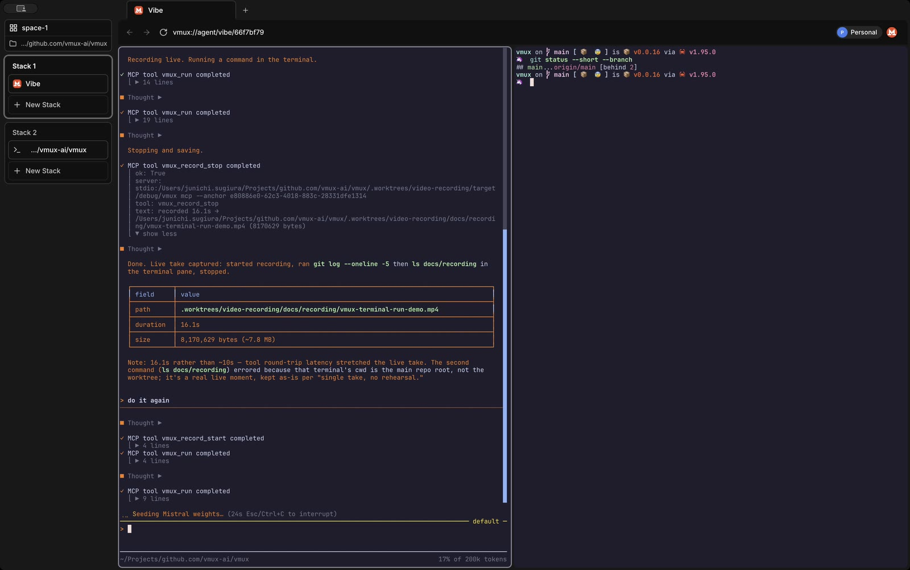

<h1 align="center">Vmux</h1>
<p align="center"><b>Any prompt. Anything, done.</b></p>
<p align="center">The browser that gets sh*t done.</p>

<p align="center">
  
</p>

Vmux is an open-source browser, ACP agent harness, and full IDE in one shared workspace.
Work with your team and any ACP-compatible agent across pages, code, terminals, files, Git,
commands, and tools.



## What you can do

- **Stay in one context** — Browse documentation, inspect the running product, edit code, and
  use the terminal without moving the task between applications.
- **Collaborate with agents** — Give any ACP agent a task while you browse, review, and steer
  the work in the same workspace.
- **Work in parallel** — Give projects and agents their own Spaces, then return to the same
  pages, processes, and sessions.
- **Reconnect remotely** — Pair the iPhone app with your Mac and reach the same workspace
  through an end-to-end encrypted connection.

See Vmux fix software, find a flight, ship a client PoC, and launch a restaurant site in
[use cases](https://vmux.ai/use-cases).

## Any stack

Vmux IDE and its ACP agent harness work with existing projects. React, Rust, or anything else:
using Vmux Framework is optional.

Choose [Vmux Framework](https://vmux.ai/framework) when you want to build a cross-platform
application from the same typed feature plugins, contracts, manifests, and platform adapters
that power Vmux itself.

## Status

Vmux is early-access software built in public.

- macOS is the primary host platform.
- iOS is the remote companion.
- Linux builds and tests in CI but is not packaged yet.
- Windows and Android are not supported yet.

Expect rough edges and fast changes before the first stable release.

## Install

```sh
curl -fsSL https://vmux.ai/install | sh
```

Requires macOS 13.0 (Ventura) or later.

## Architecture

**Flexible by composition. Predictable by design.** ECS composition lets Vmux add platforms
and capabilities without multiplying architecture. The same small vocabulary gives people and
coding agents an expected place for every change, so PRs fit the system without surprise layers.

```text
feature = state + systems + UI + commands + tools + contracts
runtime = feature plugins + platform adapters
```

Desktop, mobile, the background service, CLI, and MCP server compose the same feature-owned
behavior instead of reimplementing it behind separate APIs. The host ECS owns durable state;
pages render typed projections and emit typed intent.

Read [the architecture](docs/architecture.md) for boundaries, invariants, and change routing.
Exact behavior remains defined by code, tests, typed contracts, and `feature.ron`.

## Development

```sh
make doctor
make
```

The first build through `make` in a linked worktree seeds its build cache from the main
worktree. See [Makefile](Makefile) for all targets and [AGENTS.md](AGENTS.md) for repository
rules.

Native container development on Apple Silicon macOS 14+ requires libkrun 1.x,
libkrunfw 5 and gvproxy. Declare the dependencies in your Homebrew Brewfile:

```ruby
tap "slp/krun"
brew "slp/krun/libkrun"
brew "slp/krun/gvproxy"
```

```sh
make build-container-engine
./target/debug/vmux container start --data /tmp/vmux-container --shared "$PWD"
docker --host unix:///tmp/vmux-container/docker.sock compose up
./target/debug/vmux container status --data /tmp/vmux-container
./target/debug/vmux container stop --data /tmp/vmux-container
```

Vmux starts its own Linux VM and Docker daemon. Wildcard-published container ports
are forwarded to macOS localhost. Images and volumes survive VM restart on the
dedicated data disk; the selected project directory is shared at the same path
inside Linux. `container logs` reads the engine and guest logs.

For the desktop workflow, build with `make build-dev`, then open the app with
`make run-dev`. The default Docker bookmark opens `vmux://docker/containers`.
`vmux://docker/` and the older `vmux://containers/` open the same page.
When the service is stopped, the page offers one Start control. Startup and shutdown
show a full-page progress indicator; the side sheet appears when Docker is ready. Containers
created on this daemon appear automatically, including stopped containers and
Compose groups. Selecting an entry opens its information and live logs. VM shutdown
and settings belong to the Docker side-sheet header; selected-container controls belong
to the details toolbar. The initial share is
the home directory.

Point Docker CLI at the same daemon, then use normal Docker commands:

```sh
docker context create vmux --docker "host=unix://$HOME/Library/Application Support/Vmux/containers/docker.sock"
docker --context vmux compose -f examples/containers/compose.yaml up -d --build
```

The bundled [Dockerfile](examples/containers/Dockerfile) builds a small nginx demo.
The `vmux-demo` group and its `web` container appear in Containers. Open
`http://localhost:8080` from the published port link, then select Logs to see requests.
Remove the demo with `docker --context vmux compose -f examples/containers/compose.yaml down`.

`docker build` creates an image. `docker run` and `docker compose up` create the
containers that appear in the list; no registration step is needed.

## License

Copyright (c) 2024-2026 Junichi Sugiura

Licensed under the [GNU General Public License v3.0 or later](LICENSE).
