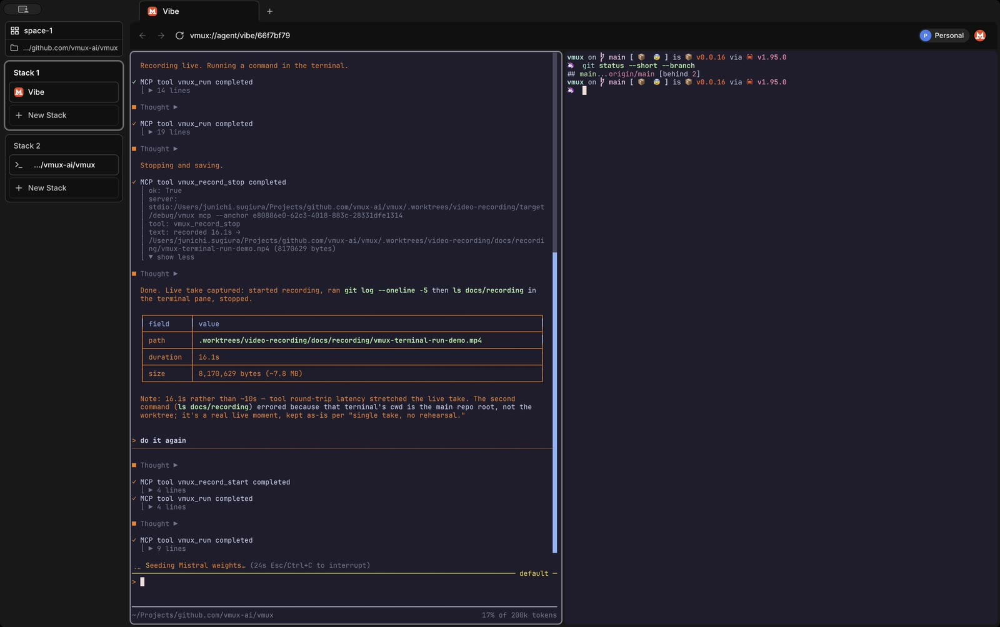

<h1 align="center">Vmux</h1>
<p align="center"><b>The browser that gets sh*t done.</b></p>

An open-source browser, AI agent workspace, and IDE. Browse, code, and work with
any ACP-compatible agent in one place.



## Install

```sh
curl -fsSL https://vmux.ai/install | sh
```

macOS 13+ · Early access. Expect rough edges.

## One workspace

- **Browse and build.** Pages, code, Git, and terminals beside your agent. Bring any stack.
- **Work in parallel.** Give projects and agents their own Spaces; keep their sessions running.
- **Pick up on your phone.** Reconnect from iPhone over an end-to-end encrypted connection.

See it [fix a bug, find a flight, and ship a site](https://vmux.ai/use-cases).

## Go deeper

[Use Vmux](docs/README.md) · [Build from source](docs/dx/getting-started.md) ·
[Architecture](docs/dx/architecture.md) · [Vmux Framework](docs/dx/framework.md) ·
[Contributing](AGENTS.md)

macOS is the primary host; iOS is the remote companion. Linux builds in CI but is
not packaged. Windows and Android are not supported yet.

## License

Copyright (c) 2024-2026 Junichi Sugiura

Licensed under the [GNU General Public License v3.0 or later](LICENSE).
