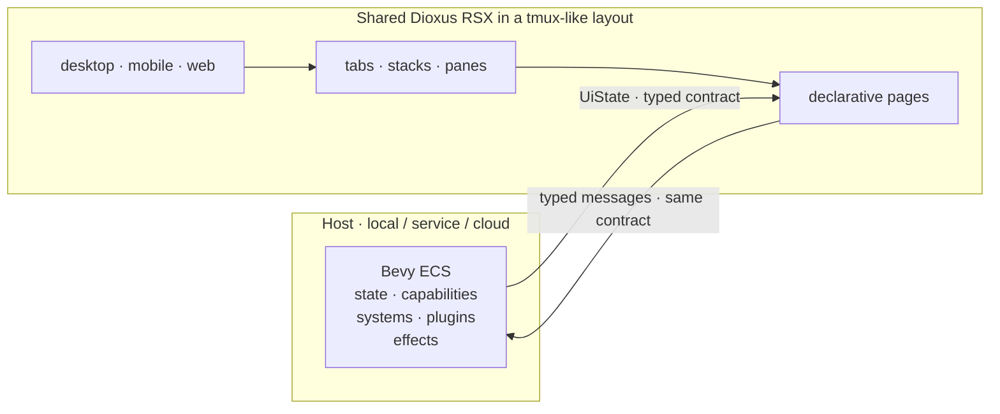

<h1 align="center">Vmux</h1>
<p align="center"><b>Any prompt. Anything, done.</b></p>
<p align="center">A browser for getting things done with agents.</p>

<p align="center">
  
</p>

Give Vmux a goal. It turns the work into a persistent session and brings the agents, context, and
tools needed to finish it into one browser.

Use it to:

- Build an app or ship a website.
- Investigate a bug or make a decision.
- Plan a trip, from booking a flight to reserving a hotel room.

Every goal becomes a session you can manage from start to finish:

- See what is active, waiting, or finished.
- Resume any session with its history and context intact.
- Group related work by project instead of reconstructing it from tabs.
- Jump directly from a session into its browser, code, terminal, files, or Git changes.

```text
┌──────────────────────┬──────────────────────────────┬──────────────────────┐
│ To do                │ In progress                  │ Done                 │
├──────────────────────┼──────────────────────────────┼──────────────────────┤
│ Plan a trip          │ Fix the checkout bug         │ Ship the website     │
│                      │                              │                      │
│ Browser · Tools      │ Agent · Code · Terminal      │ Browser · Code       │
│                      │ Git · Browser                │                      │
└──────────────────────┴──────────────────────────────┴──────────────────────┘
                         persistent sessions
```

Watch the work, steer it, or take over at any point. Close a page, switch projects, or leave the
app; the session remains ready to continue.

## One workspace for every session

Vmux combines browser simplicity with the layout power of tmux and the control of an IDE.

Open pages in tabs, stacks, or splits. Move between a conversation, its project, code, Git changes,
terminals, and live websites without rebuilding context. Agents use the same workspace and tools
you do.

The result is one interaction model for both software development and everyday web tasks.

## Architecture

Vmux stands for **Vibe Multiplexer**. The browser runs on a reusable Rust application framework:
an ECS host, declarative UI, typed contracts, and interchangeable transports.

### Built from proven patterns

- winit: cross-platform native windows, input, and event loops.
- Tauri and Wry: WebView lifecycle and IPC.
- Chromium and CEF: managed browser surfaces and web compatibility.
- tmux and IDEs: panes, stacks, code, terminals, and a Git client.
- React and Dioxus: React-like declarative UI components, written in Rust.
- Game engines and Bevy ECS: composition over inheritance with components, resources, systems, and plugins.

### Declarative UI over an ECS host

Pages are declarative Rust written with
[Dioxus RSX](https://dioxuslabs.com/learn/0.7/essentials/ui/rsx/). They render typed state and emit
typed intent; business state and long-running work stay in the authoritative
[Bevy ECS](https://bevyengine.org/learn/book/ecs/) host.

Vmux borrows composition over inheritance from the Bevy game engine: components add capabilities,
systems add behavior, and plugins assemble applications.



A session, project, page, or Git repository is represented by an entity. Components describe what
it is and what it can do. Systems react to typed events, update state, perform effects, and publish
the resulting UI state.

Because the UI depends on the contract rather than host location, pages can close, move, or
reconnect without becoming the source of truth.

### Typed once. Transported anywhere.

UI state, commands, events, and service requests are defined once as Rust types.

```text
Rust contract
├── In-process
├── Process IPC
├── QUIC
├── CLI
└── MCP
```

The transport changes; the contract and its meaning do not. Local UI, remote UI, CLI, and agents
use the same capabilities through different adapters.

JavaScript powers web surfaces, not the application architecture. React's declarative ideas are
expressed through Dioxus RSX while Rust owns state, services, and composition.

### One feature, one home

Each feature owns its complete vertical slice.

```text
Feature plugin
├── Components and resources
├── Systems
├── Declarative UI
├── Typed events and state
├── Commands and agent tools
├── Persistence
└── Transport adapters
```

Desktop, mobile, background services, CLI, MCP, and remote runtimes install the plugins they need
instead of rebuilding the feature behind another interface.

```text
Application = Plugin graph
Runtime     = Composition profile
Boundary    = Typed contract
```

Chromium pages, Dioxus UI, terminals, editors, and GPU-rendered views are composable surfaces
coordinated by the same native Rust runtime. Long-running work belongs to sessions and projects,
not to a particular window or renderer.

See [the architecture](docs/architecture.md) for the ECS, plugin, rendering, persistence, and
local/remote model.

## Install

```sh
curl -fsSL https://vmux.ai/install | sh
```

Requires macOS 13.0 or later.

## Development

```sh
make doctor
make
```

The first build through `make` in a linked worktree automatically seeds its build cache from the
main worktree.

See [Makefile](Makefile) for all targets.

## License

Copyright (c) 2024-2026 Junichi Sugiura

Licensed under the [GNU General Public License v3.0 or later](LICENSE).
