# Vmux — Architecture

> Cross-platform should mean the same architecture, not just the same language.

A common cross-platform stack uses Electron for desktop, React Native for mobile, Next.js for the
web, a separate service for background work, and another API for automation. The pieces may share
TypeScript packages and visual components, but each has its own state model, lifecycle, routing,
permissions, extension points, and application architecture.

That fragmentation appears every time a feature crosses a surface. A small change can require a
renderer implementation, preload bridge, IPC handler, main-process service, daemon protocol, CLI
command, mobile implementation, and agent schema. Each boundary can be engineered well. The cost
is recreating and synchronizing the same feature across several applications.

Vmux gives the feature one owner and gives every runtime the same composition model. The desktop
app, mobile app, background service, CLI, and MCP server are all Rust programs composed as Bevy
apps. They share the same ECS vocabulary, typed contracts, feature plugins, and scheduling model.
They differ by composition, not architecture.

```text
Typical cross-platform stack = Shared types + Separate applications
Vmux                         = Shared application architecture + Platform adapters
```

```text
Feature = State + Systems + UI + Commands + Tools + Protocol
Runtime = Shared Feature Plugins + Platform Adapters
Boundary = One Rust Type + Transport Adapter
```

One feature crate owns the complete vertical slice. Its state is components and resources. Its
behavior is systems. Its interfaces are typed messages, commands, MCP tools, pages, and wire
contracts. A protocol change, new command, or new agent tool lands beside the behavior it exposes
instead of creating another parallel implementation in an application-wide registry.

For each contract, one Rust type is the source of truth across every boundary it crosses. That
type can enter the ECS as a message, leave a page as a UI event, cross a process over rkyv, cross a
network over QUIC, or back a CLI or MCP operation. Attributes derive the required serialization,
wire identity, and boundary metadata. The transport adapter changes; the domain type and meaning do
not. There is no mirror DTO, second request enum, or hand-maintained schema for each hop.

ECS turns integration from dependencies into data. A system declares the components and messages
it reads and writes; it does not need to know who created an entity or which other systems may act
on it. Adding a component gives an existing entity another capability. Installing a plugin adds a
whole set of capabilities. Removing or replacing either does not require rewiring the rest of the
application.

Features therefore meet in the world, not in each other's internals. Their dependencies are typed
data, messages, and explicit schedule constraints rather than imported callbacks or shared service
objects. New UI, automation, persistence, or platform behavior can attach to an existing feature
without turning that feature into the integration point for everything around it.

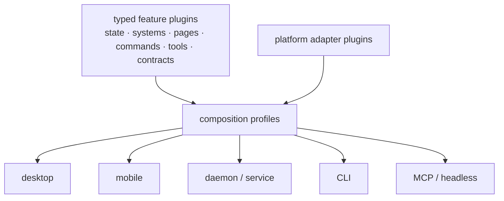

The promise is not zero platform-specific code. The promise is that platform code ends at
an adapter. Product semantics remain in reusable Rust plugins.

That changes what scales:

- **Across features.** A plugin can add behavior to entities created by another plugin by matching
  typed components and messages. Neither side needs to know the other's implementation.
- **Across platforms.** Desktop and mobile select from the same feature graph and add only
  their window, input, notification, persistence, and lifecycle adapters.
- **Across processes.** GUI, daemon, CLI, and MCP are different Bevy app compositions. Typed
  contracts cross process and network boundaries without creating another domain model or DTO
  layer.
- **Across interfaces.** A human gesture, CLI command, or agent tool converges on the same
  feature-owned request and systems instead of three implementations of the operation.
- **Across teams and agents.** New code has a constrained destination. State is a component
  or resource, behavior is a system, coordination is a message, capability is a plugin, and
  presentation is a surface. The implementation shape is predictable before code is written.

Electron applications can build daemons, mobile companions, CLIs, and automation APIs. Vmux's
difference is that these are not parallel architectures assembled around the desktop app. They
are consumers of the same typed feature plugins. **Rust is the application. Bevy is the
composition model. A boundary changes transport, not type. Web is a surface.**

---

## One platform, every runtime

```text
Application = Plugin Graph
Target      = Composition Profile
Boundary    = Rust Type
```

The same feature is composed differently for each target.

```text
Feature
├── Core systems
├── UI plugin
├── Service plugin
├── Persistence plugin
├── CLI plugin
├── MCP plugin
└── Platform adapters
```

Desktop, mobile, web, daemon, server, CLI, MCP, tools, and games are not separate architectures.
They are different plugin compositions of the same kind of Bevy application. `vmux_app` provides
the shared composition boundary; application crates select feature plugins and add the adapters
required by their platform and lifecycle.

The IDE and agent harness are the platform's creation and control plane. They can inspect the
running ECS, edit the real feature plugins, build another composition, and operate or test the
result without switching to a separate application architecture.

```text
Vmux Platform
├── Runtime
├── Plugin framework
├── Typed contracts
├── Build and package system
├── IDE
└── Agent harness
```

This is broader than a self-hosting platform:

> A composable application platform for every runtime.

> One architecture, from pixels to servers.

> Every executable is a plugin composition.

> Build the whole product with one application model.

The current repository already applies this model to desktop, mobile, the daemon, CLI, and MCP.
Web hosts, games, and other application forms are possible composition targets, not claims about
current packaging support; the current status is listed under Platforms.

Self-hosting is a strong proof of the platform. Instead of limiting users to a dynamic scripting
API, Vmux can let an agent edit the real Rust composition, type-check it, and produce a complete
application. A future custom build channel can select an immutable artifact for a profile and
retain its source revision and previous artifact for inspection and rollback.

> Vmux can build itself because Vmux itself is just another composition.

---

## Two processes

The window is a client. The work lives somewhere that outlives the window.

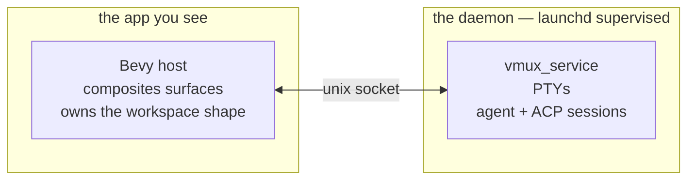

Close the window and the shell keeps reading, the build keeps building, the agent keeps
streaming. Reopen and the app reconnects, re-subscribes, and replays a snapshot.

The daemon executable and its composition root live in `vmux_service`. Shared wire values live in
`vmux_api`, connection state in `vmux_ecs`, framing and client connections in `vmux_transport`, and
profile-scoped filesystem paths in `vmux_profile`; feature crates do not depend on the daemon
package.

launchd relaunches the daemon **on crash, not on exit**, and `RunAtLoad` is false — it is
not a login item. The app starts it on demand.

---

## Three roles

Name the roles, not the devices. Every diagram below holds whether the client is a laptop,
a phone, or a watch.

- **Server** — `vmux_service`. One per host machine. Owns the PTYs and the sessions.
- **Client** — anything that renders the workspace and sends intent back. **Local** shares
  the machine with the server; **remote** does not.
- **Relay** — a rendezvous point, and not optional. A host behind NAT cannot be dialled.
  Its internals live in `vmux-cloud`; what matters here is that it forwards packets it
  cannot read.

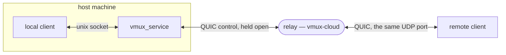

Neither end of the relay listens for the other. Both dial the same UDP port and are told
apart by the hello they open with. The remote client's packets belong to a **second** QUIC
session that terminates on the host, so the relay carries ciphertext — it holds no key and
links no crate that could decode a payload.

Nothing is dialled until Remote is switched on.

### Safe storage

On macOS, the desktop process is the Keychain boundary. It owns one non-synchronizing
generic-password item labelled `Vmux Safe Storage`, under service `ai.vmux.safe-storage`
and account `root`. The versioned 256-bit root is never passed to a child process. HKDF-SHA256
derives fixed, versioned domains for the browser, MCP OAuth storage, and each Vault:

```text
Vmux Safe Storage root
├── vmux-safe-storage-browser-v1
├── vmux-safe-storage-mcp-v1
└── vmux-safe-storage-vault-wrap-v1 + vault_id
```

MCP credentials live in encrypted Application Support files authenticated to their account
name. Vault keys live there as envelopes authenticated to the Vault ID and encrypted by the
per-Vault wrapping key. Pre-Safe-Storage browser sessions, MCP credentials, and Vault keys are
treated as absent. The CLI asks the desktop for Vault status through the authenticated service
connection and has no credential or Vault-key broker commands.

The macOS CEF patch pinned by `cef/manifest.toml` exports an embedder-only OSCrypt setter. The
desktop supplies the 128-bit browser-derived key in memory before CEF initialization. During
initialization CEF receives only the derived key and new ciphertext uses a distinct `vm1` prefix.
Chromium's existing raw-key IPC carries only this browser-scoped material to sandboxed browser
helpers, never the root or another subsystem's key.

`cef/manifest.toml` pins the CEF, Chromium, and depot_tools source revisions, patch revision,
release asset, and SHA-256 checksum. `.github/workflows/build-cef.yml` builds the macOS ARM64
artifact on the dedicated CEF runner, publishes source metadata and provenance, and
`scripts/install-cef.sh` verifies both the checksum and the custom export before packaging consumes
the framework.

### What each link carries


A page reaches its local client over wry's IPC and the `vmux://` protocol, carrying binary
DOM edits one way and rkyv events the other. The unix socket runs `u32`-length-prefixed
rkyv with a 64 MiB cap. A remote client opens one bidirectional QUIC stream per request,
carrying an rkyv `SharedMessage` and `SharedResponse`. The relay's control connection is
the odd one: a JSON hello, then opaque DATAGRAM frames it cannot read.

Remote agent operations are flat `SharedMessage` variants rather than a nested request enum.
The QUIC application protocol is `vmux/11`; changing the positional rkyv wire contract requires
another ALPN version.

Agent commands and queries use the same routed `AgentRequest` envelope. Each operation is a
separate `#[vmux_api::agent]` payload identified by its typed protocol ID; there is no aggregate
query enum. Feature crates define those payloads beside their handlers and return the generic
`AgentQueryResult` transport envelope. The service and MCP runtime route that envelope without
knowing which browser, simulator, or other feature produced it.

The hellos are JSON and everything after is rkyv, deliberately. rkyv encodes enum variants
**positionally** — a peer one release behind does not fail to decode a reordered variant,
it decodes the *wrong* one. Fine on the unix socket, where both sides ship together. Not
fine for a phone that updates on its own schedule, so the frame that decides whether to
keep talking is JSON.

---

## The ECS model

Bevy splits the atom of a React component into **data** and **behaviour**, with an id
tying them together.

| ECS | What you already know |
|---|---|
| Entity | a primary key, or a `key` prop — a bare id, no fields, no methods |
| Component | plain data bolted onto an id — one `useState` slice, lifted out |
| System | a function over every entity matching a query — `useEffect` / a reducer |
| World | the single store — one in-memory database |
| Message | `dispatch(action)` — systems never call each other directly |

```rust
#[derive(Component)]
pub struct Terminal;

fn focus_active(panes: Query<&Terminal, With<Active>>) {
    for terminal in &panes { }
}
```

Read the query out loud: *for each entity that has a `Terminal` and is `Active`, do this.*

Capabilities **compose** rather than being inherited. A plain web-view entity *becomes* a
shell the moment a `Terminal` component is added — no subclass, no base class. And because
each system declares the data it touches, Bevy runs non-conflicting systems across cores
for you.

The entity's creator does not need to predict every behavior it may gain. The system adding that
behavior does not need a reference back to the creator. Components are the contract between them,
so either side can be reused, replaced, or omitted independently. Composition changes by changing
data and plugins, not by editing a growing call graph.

That vocabulary also narrows the implementation search space. A new feature cannot hide
state in an arbitrary object graph or invent a private integration mechanism: its data,
behavior, messages, ownership, and composition point have known forms. Code remains
navigable as the number of features and authors grows, including when the author is an
agent generating the implementation.

A custom `SystemParam` names a coherent capability over the world. Use one when related
queries, commands, or message access would exceed Bevy's system-parameter arity or when it
makes a system materially easier to read and follow, especially when lookup and validation
rules are shared by several systems. Its methods may synchronously inspect or update the ECS
data it contains. The calling system still owns request iteration,
lifecycle transitions, asynchronous task boundaries, cross-feature dispatch, and schedule
ordering. A miscellaneous parameter bundle or a large hidden `run`/`dispatch` workflow is not
a capability and stays as ordinary system logic.

Asynchronous work remains explicit ECS state. A finite filesystem, process, or compute operation
is a task component on the entity whose lifecycle it advances; one system starts it and another
consumes its result. Long-lived runtime-specific I/O, streams, retries, and timers belong to a
transport actor that exchanges typed inputs and outputs with ECS. Coroutine runtimes with ambient
world access are not the default because they hide scheduling and lifecycle state from queries.
Use one only for isolated sequential UI choreography where the sequence itself is the behavior,
never for blocking work, transport ownership, or ordinary domain transitions.

System names use their module as context. Prefer `open`, `refresh`, `bind`, `project`, or
`request_definition` inside the owning module over names that repeat the feature, module,
transport, and request type. Keep a longer name only when two systems in the same module would
otherwise be ambiguous.

Not every Rust value is ECS state. Use a component when a value has identity, lifecycle,
independent mutation, observation, or scheduling significance. Use a message when ordering or
cross-system delivery matters. Keep immutable specifications, parsed manifests, serialization
adapters, validated values, and deterministic transformations as plain Rust types. Promote one
to ECS only when the world must address, observe, replace, or schedule it independently; wrapping
a temporary function input in an entity adds indirection without composition.

Keep those non-ECS values in the owning feature's noun module, and put external side effects in a
named boundary module such as `acp/install.rs` or `transport.rs`. Do not create a generic `util`
drawer. `host.rs` and its root plugin remain the composition entrypoint; private systems call the
boundary adapter and project its result back onto ECS entities.

### Plugins

One crate, one capability, one `build()`. A plugin bundles its components, systems,
resources, messages and observers and registers them in one call, so a reader sees the
whole feature in one place.

```rust
app.add_plugins((TerminalPlugin, EditorPlugin, ServicePlugin, BrowserPlugin, ...));
```

Plugins do not call each other. Cross-crate behaviour flows through messages and
components. Composition all the way up: components compose an entity, plugins compose the
app. Large capabilities follow the same rule internally: their root plugin is a table of
contents that composes lifecycle, interaction, presentation, and persistence plugins. A
system stays private beside the plugin that schedules it, so ordering and run conditions
cannot be bypassed by another module.

`vmux_app` is the platform-neutral composition boundary. Applications select a profile and
override feature availability through one builder; individual feature plugins remain usable
without the facade.

Every product feature appears exactly once in that graph and exposes one crate-level plugin.
That root plugin installs only its own manifest, components, systems, and private subplugins. It
never installs a sibling feature plugin. Cross-feature requirements belong to the `vmux_app`
builder. `vmux_desktop` and `vmux_mobile` add only platform adapters and select a shared profile;
they do not become alternate feature registries.

```rust
app.add_plugins(
    VmuxPlugin::builder()
        .desktop()
        .git(false)
        .simulator(false)
        .build(),
);
```

Cargo features decide which integrations are compiled. Builder options decide which compiled
plugins are installed. Desktop and mobile are official consumers of this same API; platform
windows, menus, persistence, notifications, and device lifecycle remain adapter plugins in the
application crates. Third-party features integrate by publishing a plugin that owns its pages,
commands, tools, contracts, systems, and platform capabilities.

Page crates use one physical layout. `host.rs` composes Bevy plugins and `host/` owns ECS
components and systems. `ui.rs` exposes the Dioxus page entry point and `ui/` owns its UI
subtrees. `state.rs` owns shared UI snapshots and patches; `event.rs` owns transient UI-to-host
and host-to-UI operations. Generic `page.rs`, `page_state.rs`, `ui_state.rs`, and `view.rs` modules
are not used because their ownership is ambiguous.

Page manifests are static plugin registration data. Their registration entities exist during
plugin construction so the browser can build the complete embedded-host allowlist before CEF
initializes. Runtime page state and behavior still initialize through ECS schedules.

Each feature keeps one `src/feature.ron`. `pages`, `tools`, application `commands`, and settings
schema contributions are owned beside the feature that implements them; `cli` is the optional
command tree. The settings feature aggregates those contributions into the `SettingsSchema`
component on each settings page entity. String-keyed pseudo-sections are not namespaces. A
crate declares one `FeatureManifestSource` marker. Feature entry paths install the generic
`FeaturePlugin`, which parses the runtime sections once and registers one ECS entity containing their
typed metadata. Repeated composition reuses that entity. Tool, command, CLI, and MCP catalog consumers
read only the metadata they own from it. Page attributes read the same file at compile time. Feature
plugins bind typed behavior without reparsing a named subsection or teaching an application crate
which features exist. The first page is the feature's default page; only additional pages need a
`name` for an explicit `page = "..."` selection.

`vmux_app` exposes reusable feature-plugin composition without owning executable policy. Page
manifests, hosted-page plugins, command-bar contributions, and typed MCP tools remain in their
owning feature crates. A custom
MCP binary builds a Bevy `App` with `McpPlugin` and its tool plugins, then gives that app to the
stdio transport adapter. The runtime entity carries the `McpServer` component; tool handlers own
their typed manifest variant and return a typed command or query dispatch target.

Names describe domain semantics before transport mechanics. Implementing Bevy `Message`
does not add a `Message` suffix. An operation to perform is a `Request`. A validated,
deterministic internal state change is a `Mutation`. Something that occurred is named in
the past tense or uses `Event`. Current state is a `Snapshot`; an operation outcome is a
`Result`. `Command` is reserved for application, agent, and service command protocols or
actual Bevy world commands. `Message` is reserved for protocol envelopes and conversation
content.

Shared API values use `#[vmux_api::contract]`, which supplies the serde and rkyv representation
plus the common value derives. Unit contracts infer `Copy`, `Default`, and `Eq`; contracts with
fields opt into only the additional traits their fields and semantics support. Binary events use
one directional attribute instead:
`#[vmux_api::ui_event]` marks an event emitted by Dioxus and consumed by the Bevy host, while
`#[vmux_api::host_event]` marks the reverse direction. Both event attributes include the contract
derives and define the complete wire name, version, and allowed page hosts. `BookmarkMenuPinRequest`
therefore has the wire id `bookmark_menu_pin@1`, with its module-local `Events` family supplying
the `layout` target. A namespace would duplicate the target and the type prefix. Both UI-to-host
decoding and host-to-UI delivery reject a mismatched host before decoding the data.

`#[vmux_api::ui_state]` is the state-specific host-to-UI contract. It includes the contract,
`HostEvent`, and `UiState` implementations, while `#[vmux_api::ui_state_patch]` supplies the
serializable typed patch mapping. `#[vmux_api::host_event]` remains for one-shot notifications and
responses that are not page state.

Read contracts belong to a capability rather than a page. A client subscribes to typed resource
selectors; the host derives and publishes only that selection, and multiple pages share the
underlying read. The transport carries the resulting projection, not the entire ECS world.
Immediate presentation choices remain local to the client.

Command palette queries are UI input, while filtered rows, completion text, prompt targets, and
mode are a host-owned ECS projection on the page entity. Dioxus renders that projection; immediate
text entry, selection, submission, focus, caret, and IME behavior remain local until the input and
effect audit is complete.

Command-bar requests implement `CommandRequest` and are registered through `CommandTypePlugin`.
Their definitions become ECS entities with targeted dispatch observers; no callback registry owns
their behavior.

Commands, MCP tools, and tool-store actions share one extension shape. A runtime plugin owns only
generic catalog, routing, scheduling, and completion mechanics. Each feature plugin owns its typed
request or operation, definition manifest, parsing, and dispatch systems. Root plugins compose the
built-ins, while another crate can install the runtime plus only its own typed plugins; application
crates contain composition and platform adapters, not provider-specific routing tables.

---

## The layout tree

Ownership is structural — an element's position in the tree *is* its identity.

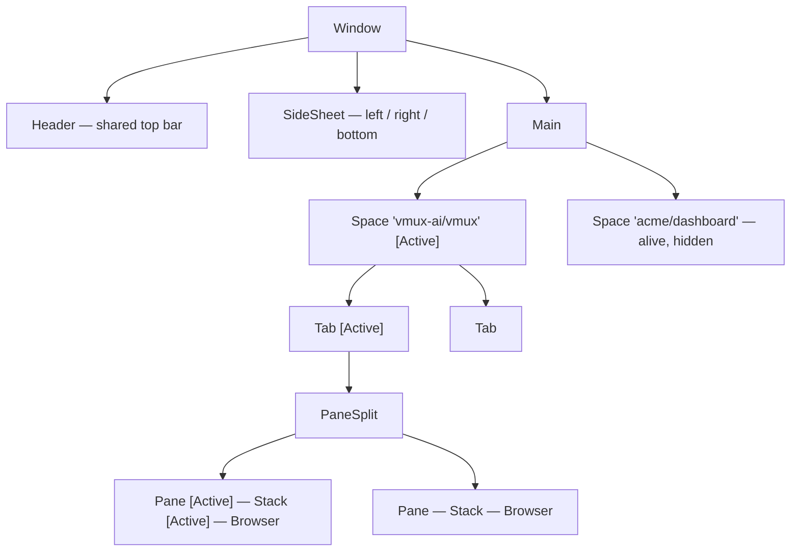

Each native Bevy `Window` owns one complete tree. Its root carries `VmuxWindow`,
`HostWindow(window)`, and `FlexViewport(window)`; the header, side sheets, main area,
spaces, tabs, panes, and hosted surfaces descend from that root. Descendants resolve their
native owner through this ancestry, so sizing, visibility, and browser/native surfaces stay
inside their window.

`FocusedWindow` is the cross-tree selector. Global commands, keyboard focus, capture, and
the single command-bar overlay follow the focused native window; `Active` selections are
interpreted within that window's tree. Closing a window removes only its tree and promotes
another window if the primary closes. The primary tree and geometry persist across launches;
additional windows are runtime workspaces.

Native page frames keep their top edge fixed in their parent view's coordinate system.
Flipped AppKit parents use a flexible maximum-Y margin, so restoring the window's height cannot
shift a page down by the size difference before ECS observes another resize.

UI input carries its originating surface. The layout resolves that origin to one native window,
its current Space, and a concrete Stack before applying the request; later systems do not retarget
it through global focus. Menu, shortcut, and agent commands without a surface intentionally use
`FocusedWindow`. Creating another window captures the source Space before focus moves, so startup
state and side-sheet state cannot be read from the empty destination tree.

Space IDs are global identities. Every window may attach its own `Space` view for the same ID;
selecting a space that is not attached creates a fresh local tab and pane tree. Names, project
settings, and history are shared by ID, while tabs, panes, focus, expansion, side sheets, and
other layout state remain local to each window. Only the primary window's views persist.

- **Space** — a project identity with a window-local view. Exactly one view per window is
  `Active` and drawn; the rest stay alive.
- **Tab** — a saved pane arrangement.
- **Pane / PaneSplit** — a recursive row/column tree. `tmux`-style tiling.
- **Stack** — several leaves in one pane, cycled like browser tabs.
- **Browser** — the leaf: a web page, a terminal, or an agent.

Each Stack owns three page components with one reducer. `PageNavigation` is the requested page
identity; projected `PageMetadata` updates immediately for the URL, breadcrumb, tab, and side sheet.
`Current` is the committed surface and its metadata. `Transition` exists only while one incoming
surface advances through loading, paint, presentation, animation, and commit acknowledgements.
Readiness stays inside `Transition` so acknowledgements cannot form invalid cross-request component
combinations, while
paint updates do not mark `PageNavigation` or `Current` changed and therefore do not invalidate
unrelated layout projections. Metadata projection, surface removal, and handoff settlement run only
when their source components change; transition deadlines are checked at a bounded cadence rather
than polling every surface on every frame. A failed or superseded request discards the incoming
surface and leaves `Current` untouched. Request IDs reject acknowledgements from stale surfaces.
Layout projections observe `Current` changes even when the requested metadata stays the same, so
committing a presented surface clears the side sheet's pending-page indication immediately.
Scroll and scroll-end events use asynchronous native delivery, coalesced to the latest position per
element and event kind within one animation frame. Keyboard and pointer events retain synchronous
replies for cancellation; queued scroll events are discarded when their document or interpreter
changes, so native round trips cannot pause scrolling or affect a replaced page.
The selected tab's favicon spinner follows the page after 150 ms of continued loading, avoiding
brief flashes on fast local reloads without delaying the page. Reload then becomes a stop button;
stopping cancels browser loading and rolls an uncommitted handoff back to its retained page.
Inactive restored pages do not animate the selected page's controls. A selected Start page requests
composer focus again when its document becomes ready, including a reused prewarmed page.
Loading feedback includes the reload revision and page URL in its identity, so a completed delay
cannot light up the next reload of the same stack. External-page address rows keep their origin
pill and text; their favicon remains in the tab.
Renderer-only `PrewarmPage` pools prepare Code and Terminal surfaces without intercepting their
page requests. `RendererPool` leases ready surfaces once within the target window; feature plugins
seed minimal context and still own file selection and PTY creation. Claiming a surface clears its
old presentation acknowledgements before the new page's first usable frame appears.
Dormant stack entries keep their page icon until a visible load is requested. Keyboard commands
from the user target the focused page; page-origin commands retain their window scope. Hosted-page
reloads publish loading immediately and clear it on the matching ready handshake or cancellation.
The favicon loader rotates a growing and shrinking arc. Diff loading surfaces retain their full
geometry while showing a short, sparse preview with thinner bars and blank rows; known file headers
remain visible while their bodies load.
Native pages keep the committed surface until the incoming layout has painted and native placement
is ready, then commit immediately without a timed fade. Content pages use the same presentation
lifecycle. Feature page-open handlers create or retarget the incoming surface;
they never despawn the committed surface themselves. Only the page reducer retires it after
presentation commits.

Stack and Tab replacement uses one presentation transition. Selection changes immediately, while
the projection keeps the outgoing branch visible until a ready presented surface exists under the
incoming branch. The same projection drives Bevy layout, CEF visibility, OSR focus, and native
window frames. Settlement removes the transition and retires the outgoing branch in one frame, so
navigation, close, restore, and reuse cannot expose the window background through separate paths.

Page intent commits to ECS immediately: the selected Stack, optimistic URL metadata, breadcrumb,
and side-sheet projection change in the input frame. Surface creation and data refresh continue
behind that committed intent. `UiStatePlugin` retains a small route-keyed snapshot cache for every
typed page state. Reopening a route replays that snapshot before a background refresh, so cached
content remains usable and loading placeholders describe only data that has never existed. Page
readiness is deferred until the current render has registered its state listeners. Incoming pages
remain input-inert but may exchange typed initialization events. The document carries its initial
DOM frame; the interpreter applies it as soon as the root exists, and its first poll acknowledges
that frame. Presentation uses the first usable layout, including reserved placeholders, while
later data arrives as incremental frames. This gives every vmux page one stale-while-revalidate lifecycle
instead of feature-specific loading gates.

Live UI-state frames apply patches in place. Unconsumed increments remain queued across later
frames until their component processes them; constructing a retained cache snapshot is a separate
operation. A controller or catalog update therefore cannot discard diff chunks awaiting a render.
Project catalog workers retain their result until the matching initial detail state exists, so a
fast first-frame completion cannot discard the breadcrumb's project choices.

DOM delivery and presentation are separate acknowledgements. Delivery releases the next edit
batch. Layout, selection, focus and routing respond in the input frame; background data, fonts
and stability timers never hold a layout transition. The incoming page presents its first usable
layout, including reserved loading geometry, at the first paint opportunity. The outgoing surface
covers the handoff until that paint. Initial transcript placement runs before messages become
visible, and later updates preserve the visible row and scroll position. Rehydration invalidates
the old paint acknowledgement.

Native interaction-state updates are repeatable: each update changes the IPC epoch and the
document's inert state without adding persistent JavaScript bindings.
Page-local navigation uses `PageLocationRequest` and `PageLocationUiState`, with the fragment
stored in `PageMetadata`. Fragment-only changes update the hosted URL and the committed Stack
without rebuilding the document or changing its data-cache identity. Pages resolve that shared
location to their own file or section and use the common scroll transport; Settings can consume
the same location state for its section navigation.
Git file selection and the editor Outline share `SectionNavigation`: clicks request smooth
scrolling, scrolling publishes the current section, and echoed location updates do not restart
navigation. Notes resolve `#L<line>` to a rendered block and measure the heading at the viewport
edge in one DOM request. Outline following preserves the editor caret. Page routes are declared once in `feature.ron`.
`PageManifest` supplies the default breadcrumb title, translation key, icon, and destination;
the registered manifests supply the page-switch menu. Pages publish only typed `PageAddress`
data through `AddressContribution` or `PageAddressPublish`: the current route, project and session
choices, directories, symbols, and their intents. `vmux_layout` renders the active surface with
one `AddressTrail`. No page component, callback, context, or mounted slot crosses into Layout.
Hosted subtree registration also extends its route metadata's ownership. During navigation,
Layout reads the incoming surface and existing breadcrumb choices supply the selected label and
icon immediately, before the page publishes its enriched address.
The URL row contains routing breadcrumbs and page-type icons. Project and branch selection stays
in the Space card; Code and Session trails contain their viewed file or Session without repeating
that workspace context. Code and Git use `file://` and `git://`; their root
bookmarks resolve the working directory selected in the owning Space card through shared
`page_context::Context`. Git view and commit or stash selections use query parameters. Its
checkout follows the owning workspace, and old `vmux://git/` routes normalize before rendering.
Search, filters, Details, Add, Create,
Resume, Start, and Checkout render inside the page through `PageToolbar`, with local callbacks.
Git's document, styles and UI transport share the `git://` origin. Code uses `file://` for
navigation and `vmux://files/` for the native renderer: WKWebView reserves the built-in file
scheme and rejects a custom handler. Page routing and renderer asset origins are separate
metadata; an asset origin never becomes a bookmark destination.
The command bar displays decoded URL path segments, including embedded file paths. Edits retain
their original segment boundaries; navigation and whole-URL copies use the canonical encoded URL.
Ordinary bookmark clicks reuse an existing Stack or open one. Cmd-click, with or without Shift,
opens a new Tab after resolving any project context.
Fragment updates retain the page's breadcrumbs instead of replacing them with the generic route.
`PageAddressRequest` validates the source window, active surface, revision, and URL before sending
`AddressIntentRequest` to the page. Navigation opens in the owning Stack; page-local selection
uses a versioned `AddressEffect` consumed by `PageBreadcrumbs`. Effects bind to the source URL,
owner, and address revision and are removed from retained snapshots to prevent replay on reload.
Layout overlays distinguish DOM popovers from panels. Popovers keep native pointer capture,
while their DOM decides outside-click dismissal; static header and sidebar rectangles cannot
close a popover before an item below them receives its click.
Popup state belongs to the Layout that renders the breadcrumb and uses its existing overlay
capture until dismissal or disposal. Hiding the window header leaves the full page working area.
Space-card Project and Branch selectors share hover opening. Their menus align with the row
on its right, falling back to the left at the viewport edge. A first click after hover keeps
the menu open; the shared leave delay allows the pointer to cross the gap. Each opening advances
an activation revision, so delayed closes and listeners from an earlier opening cannot dismiss it.
Path overflow collapses whole directories using measured widths and keeps the filename intact.
Git's branch-file filter sits above its file tree, with page-top spacing shared by the tree and
diff. Side-sheet cards share their outer width; the Space card keeps an inner right inset.
Long titles and branch labels fade at the edge,
and paths retain their filename with a leading fade. Hover exposes the full label.
Session tabs and side-sheet rows share their Session identicon, with the agent logo in a small
corner badge. Address identicons use the same size as the adjacent navigation icons.
Agent thumbnails contain their logo inside the circular avatar surface, including its border.
Session breadcrumb controls fit their text, leaving the remaining address surface available for
URL editing. A hover control copies the active URL. Session selection requests the full page-open
lifecycle in the current Stack so its Session target and runtime follow the selected URL.
Code bookmarks resolve their directory from the active worktree, owning project, or cwd and open
its README or entry file; directory favicons identify the Code page. Layout and address state flush before native
presentation in the same frame; the final flush retains updates arriving later.
Project rows carry an identity separate from their checkout path. Space cards, composer chips,
project pages and Session metadata use that identity for identicons; branch icons use the branch
name consistently. Moving a Project between worktrees preserves its icon.
Spaces use their immutable Space ID for the same identicon in lists, menus and cards. Renaming
changes only the display name, preserving tab membership and the icon. Commit selections use the
full object ID for identicons in both the URL trail and its menu. An unselected Commits view picks
the latest commit after its initial catalog arrives and writes that selection into the URL;
explicit object IDs remain selected independently of the current branch's history.
Project detail trails reuse the asynchronous Project catalog for their switch menu. Cached choices
remain available across project navigation, and completing a catalog refresh preserves the detail
view rather than replacing it with the Project list.
Search and page controls share `page::PageToolbarRow`, a 32 px row. Collection sidebars use the
same default width as Code's file tree; their search and navigation icons share a 12 px left inset.
`manager::ManagerSearch` fills that row with 13 px text and a subtle focus surface, retaining its
width and height during input. Editor tabs remain beside the sidebar search. The sidebar's scroll
region starts below it. Filter menus use the shared popover layer and may extend beyond the
sidebar without changing the search row, editor tabs, or content positions.
Git's initial skeleton and loaded dashboard share the same split layout, sidebar width and
toolbar rows; loading does not add a second breadcrumb header inside the page.
Initial page subscriptions use `DeferredSend`: blocked surfaces retain the latest request by
event ID and replay it only for the current navigation and source epoch. Navigation changes
discard old requests; effects observe the navigation revision and reissue their current data.
Ordinary input remains blocked until the surface is interactive.
Tab presses and Stack card clicks select immediately; host projection reconciles their local
selection. Earlier acknowledgements cannot replace a newer pending selection.
UI motion is feedback rather than a completion condition. Selection, URL, focus, and the target
layout commit in the input frame; no request waits for an animation, and fresh input supersedes
an in-flight transition from its current visual state. Native layout and shared UI animations
use `vmux_ui::motion::Motion`: 80 ms for feedback, 100 ms for content, and 120 ms for layout, with
a 160 ms ceiling enforced at DOM animation transport boundaries. Reduced motion uses the same
state changes without visual interpolation. Same-document navigation and input-epoch changes
retain in-flight edits and existing component scopes. The current document acknowledges a frame
by its unique sequence after identity resynchronization, while old input and DOM requests remain
rejected. Actual document replacement or failed edits still rebuild the document. Page replacement
does not animate the whole surface or translate a shared composer; shared sidebar rows stay in
place when page selection changes. Session detail-panel visibility belongs to the page shell,
and its geometry remains reserved while the selected session loads.
Session viewports remember their scroll position and loaded-history start on the owning Session.
A floating composer overlaps the transcript's lower edge, with an input-inert surface gradient.
Transcript end padding keeps the latest message clear of the composer and its fade.
A revisit restores that history window and reader position; the first visit follows the tail.
Initial tail following remains active until user scroll input. Placeholder and zero-height scroll
events neither finish placement nor replace the remembered reader position.
Viewport updates validate the originating page URL and Session ID; where a canonical Session ID
is available, transcript readiness is bound to it. These viewport records are transient.
Discrete tabs and search widths change immediately. Removing a tab retains an inert, identifier-free
copy of that specific tab for an 80 ms fade. Remaining tabs move from their previous rectangles
within the 160 ms budget, while selection and the actual layout update immediately. Reduced motion
skips both effects. A cached Stack returning from a hidden,
zero-size frame restores its final rectangle immediately. Collapsible content may interpolate height
within the shared layout budget. The editor sidebar keeps one panel icon in both states.
Its width, short slide, and opacity use the
120 ms layout budget with a fixed inner width; pointer resizing and reduced motion skip width
interpolation, and opening never waits for page data. Cached pages remain usable during refresh;
new data occupies a reserved skeleton region, and page replacement keeps the outgoing surface
until the incoming snapshot paints. Tests exercise fresh input during motion, stale paint rejection,
and retained-page handoffs instead of asserting animation class names. URL-bar background and
padding stay independently clickable and expose the URL on hover; breadcrumb controls keep their own hit targets and events.
Address-path measurements live in an inert, invisible row outside normal layout, so hiding a
directory never removes its width measurement or changes the available inline space. Zero-size
notifications from detached surfaces and subpixel noise retain the previous layout.
Dropdown, Select, and context-menu state belongs to their respective controls; their popup
presentation shares `vmux_ui::components::popup::Surface`. The page interpreter raises, positions,
and focuses new popovers in the mutation frame, before mounted callbacks. Menus fade in from
transparent with a small vertical movement in 100 ms; closing releases interaction immediately and retains
an inert, identifier-free snapshot for an 80 ms fade. The snapshot retains typography and scroll
offsets. New input can discard it, and reduced motion skips interpolation.
Selected dropdown entries are revealed inside their own menu before its first paint. Mounted setup
and later renders preserve that position; fresh pointer, scroll and text input own it thereafter.
Command bars, menus, selects, tooltips and dialogs share `popup::Dismissal`. Document deactivation
closes them through their owning state; moving focus between fields leaves them open. The macOS
application resignation notification dispatches the same lifecycle to every hosted page, so native
focus transfers cannot leave a popup behind. Command-bar deactivation never restores keyboard
focus to a background window.
Collection and Code search reuse `manager::ManagerSearch` at the top of their sidebars. Code keeps
its file tabs and view controls in the first page row; search never reserves an empty row above it.
Search has no surrounding field frame and fills its reserved sidebar row. Code keeps regex and
matching options in a menu, and root-folder headings own the Explorer hover controls. Markdown
outlines publish after document metadata, so a navigation reset cannot discard newly parsed headings. File-list
placeholders retain the real 22 px row height with file outlines and short name bars. Rendered-note
carets share a thin, font-sized style without a surrounding shadow.
Note editing keeps the rendered block in normal flow and centers the source overlay inside that
reserved area, so extra source lines occupy the space above and below without moving adjacent blocks.
Session view and category controls live in the page toolbar. Section headings support right-click
and overflow menus for bulk archive, restore, and folding.
Activation stamps preserve operation order across shared ancestors even within one clock tick;
stack navigation consumes a batch against one advancing cursor and excludes retiring targets.
Sidebar choices and stack shortcuts share that activation path, including nested pane ancestors.
After layout and native placement, a completed surface with matching generation, navigation,
bounds, and full native opacity can finalize selection, input ownership, and stacking in the same
frame. New handoffs retain their existing readiness and animation conditions.
Session rows use memoized repository lookup and group metadata; rendered Wry frames join the
native pointer registry so native scrolling does not generate unnecessary layout wakes.
History swipes use a shared horizontal-wheel recognizer. Horizontal scrollable ancestors consume
movement until their boundary; zero-delta starts and small initial axis noise do not cancel a swipe.
A transient arrow at the corresponding viewport edge tracks gesture progress and fades on commit
or cancellation. Its isolated, input-inert layer does not participate in page layout or delay navigation.
Source-bound requests reuse host history before browser history. The dedicated CEF gesture bridge
keeps general-page IPC permissions unchanged; both backends require one matching, recent native
wheel claim for the current surface, window, frame, and direction before moving history.
Accepted lifecycle batches also carry the current document revision into paint state; an old
mount notification discarded during an interaction-epoch change cannot leave the first paint
waiting on revision zero.
Dirty pages flush against the native document's own parked poll; asynchronously mirrored frame
telemetry does not gate delivery. Start keeps prepared replacement surfaces so closing the last
view can reuse a loaded page while its workspace context refreshes.
Rebuilding the same document preserves its guarded host-state listeners. Only replacing the
page component clears those bindings, so an input-epoch change or frame retry cannot leave a
mounted page subscribed to a registry that no longer exists.
Full document recovery replaces the VirtualDom and reapplies its supplied contexts. Rebuilding
an already-mounted VirtualDom leaves prior component scopes alive, so their queued updates must
not be allowed to address nodes in the replacement document.
Before replacing those scopes, the page captures their retained typed UI state. The replacement
document starts from that state, so an interaction change with an unacknowledged frame cannot flash
loaded content back to skeletons. Capturing happens only during recovery; replacing the page creates
a fresh state store.
The requirement to replace the document is latched outside the transient DOM request queue. A later
navigation or input-epoch update may clear transient requests, but the full rebuild still carries one
remount stamped with its current identity. Full rebuild edits never append into the previous tree.

Custom-scheme asset requests enter the response queue in the same update that receives them.
Pending responses wake the reactive host loop and keep the CEF pump responsive until delivery;
after delivery, both return to their normal idle policy.

Start's branch lookups share one pending read per project across their requesting surfaces.
They run on the bounded Git background workers, so synchronous Git subprocesses cannot occupy
the asset loader's shared IO task pool during startup.

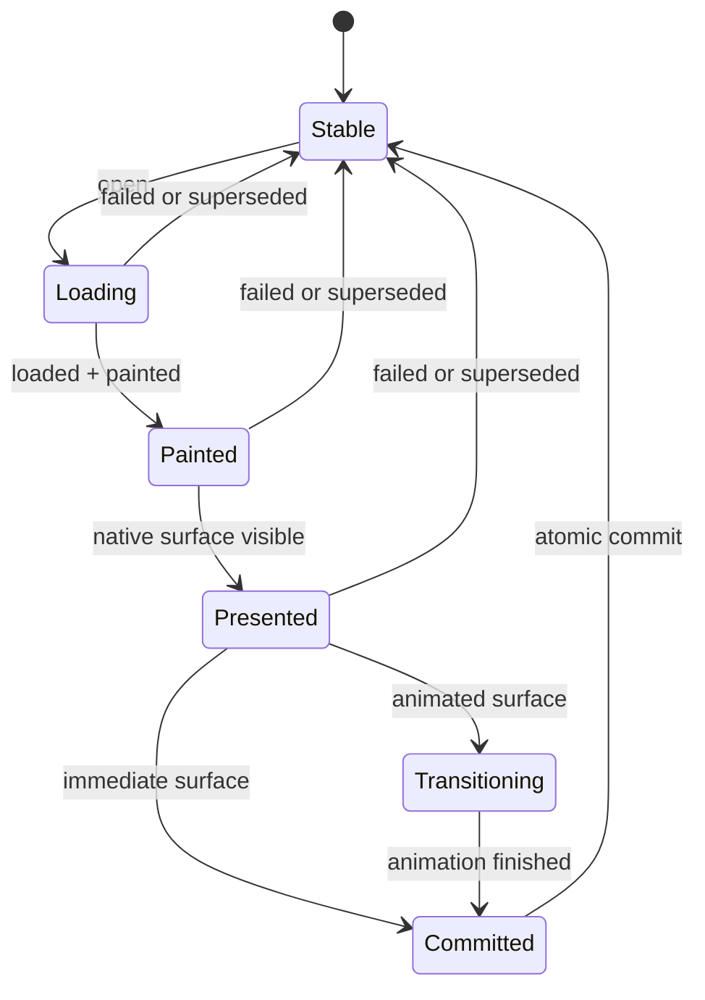

**The selection invariant: at most one `Active` child per parent.** Focus is found by
walking `Active` down the tree. `LastActivatedAt` records MRU order and selection intent; one
layout reducer projects it into `Active`. Consumers use that projection and consult MRU only while
repairing an incomplete restored tree. Native adapters never infer selection independently. Small
`ensure_active_*` systems run when selection or topology changes, so if a human or an agent destroys
a node the gap heals in the same update without scanning the tree on unrelated frames.

A tab is owned by its Space *entity*, not a loose string key, which sandboxes mutations
inside that Space. Cross-space leaks are impossible by construction — the legacy model
tagged tabs with a detached id and computed selection globally, which let creating a space
corrupt another's panes.

State snapshots to `store.ron` via `moonshine-save`. A schema-version sidecar hard-resets
on an incompatible version rather than loading a broken store.

World persistence uses named type-registry domains. A persisted component or resource registers
once with its domain; that metadata produces the component and resource allowlists used by saves.
The workspace domain tracks component changes only on entities marked `Save`, including removals
and despawns. Its hierarchy tracker compares names and relationships by value so reinserting an
unchanged hierarchy cannot restart autosave. Dirty state saves after 500 ms of quiet, with a
60-second deadline for continuous changes; coincident deadlines write once, and clean workspaces
do not write periodic snapshots. Specialized domains such as bookmarks keep their own entity
scope, dirty policy, path, migration, and seeding lifecycle.
Automatic saves capture an immutable world on the main thread, then serialize and atomically
replace the file on the I/O pool. An in-flight save keeps later edits dirty; completion wakes the
app and never clears newer changes. Explicit saves finish an earlier write to the same path first.
Failed writes retain the changes and retry on the 60-second deadline; schema sidecars follow
successful writes. Restored session children containing only a timestamp and parent reference are
discarded after backing up the store; conversation content and live children remain intact.
Workspace loads validate Space, Pane, and Session IDs and the ownership graph before replacing
live entities. Space roots may reference the runtime window outside the snapshot. Failed loads
discard partial entities, preserve the store and schema sidecar in a recovery backup, and let
startup create a usable workspace. Saves cannot overwrite the failed store until that backup exists.

Accepted project selections own their Git tasks on transient `Operation` entities. Each operation
references its Tab and captures the selection revision; replacement, retirement, or removal cancels
the old work before it can apply. Cleanup guards dispose of discarded checkouts. Results remain
inspectable as `Succeeded`, `Failed` with an error, or `Canceled` for five minutes before cleanup.

---

## How it paints

Two engines, and which one draws a surface depends on what the surface *is*.

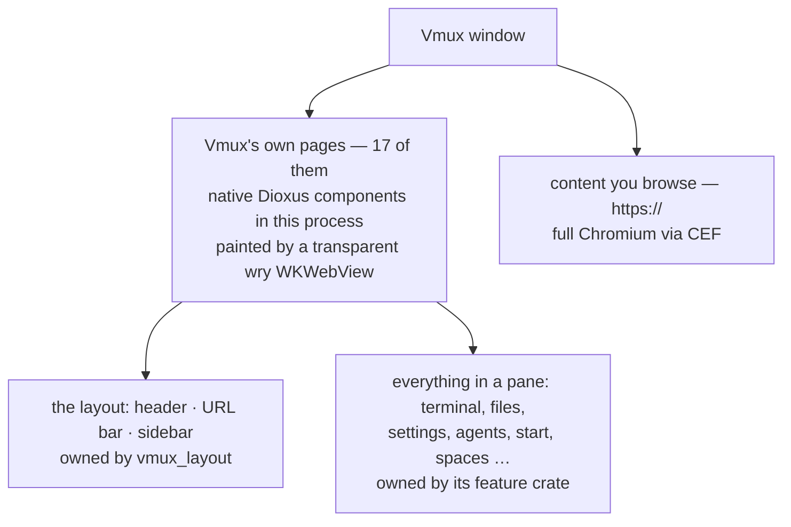

**Vmux's own UI is not a web app any more.** Seventeen pages — the layout overlay included —
run their components as native Dioxus in the host process, each painted by its own
transparent `wry` webview. There is no wasm build of the UI and no `vmux://` page inside
CEF. Even the command bar, which used to be its own webview, is now a panel drawn inside
the layout page; the entity that survives holds only the state thirty-odd readers ask
"is the bar open" through.

Every one of those webviews is handed a `WKWebViewConfiguration` carrying one shared
`WKProcessPool`, which cut the cost of building a webview from 25–40 ms to 2–6 ms. Why it
helps is not settled: `WKProcessPool` is deprecated on the grounds that extra instances no
longer do anything, and a running app still shows one WebContent process per page rather
than one overall, so the obvious explanation — that the pool collapses those processes and
skips their font enumeration — is not what is happening. The `#[allow(deprecated)]` stays
because the number is reproducible; treat the mechanism as unknown rather than as described.

They are also told `allowsLinkPreview = NO`, which reads like a nicety and is not. It is
what removes AppKit's force-click gesture recogniser. Left on, every press asks WebKit for
an immediate-action hit test; WebKit answers by building the dictionary popup's
`TextIndicator`, which needs a raster snapshot from the GPU process and waits for it on a
semaphore **on the page's main thread**. Measured on the composer chips that cost the
better part of a second on roughly one press in five, worst on the chip whose tooltip
carries a whole worktree path, because that offers the longest range to snapshot. The
press was delivered, the thread then stopped, and mousedown, mouseup and click all arrived
together when it came back — which is why it reads as a dropped click rather than a slow
one. No page here wants force-click inside its own UI.

**Content pages are still CEF.** `Browser::new` is the leaf that carries them — windowed,
natively focused — so scrolling an `https://` page costs what Chrome costs. CEF also still
backs the extension bridge pages, and the windowless path it paints offscreen.

The simulator page is a native pane backed by `axe`. The host attaches to a matching booted iOS
Simulator or boots the latest available device, copies its MJPEG stream to a loopback socket, and
turns normalized pointer and keyboard events from the page into guest input. MCP exposes the same
attached device through screenshots, pixel-addressed taps and swipes, text and key input, and
hardware buttons. Copy and paste synchronize the host and guest pasteboards before sending the
matching iOS keyboard shortcut. Other modified keystrokes are forwarded as HID combinations so
native text selection and editing shortcuts behave like Simulator.app. CoreSimulator presents the
native iOS software keyboard while the page is attached. Vmux performs that private-framework call
in a short-lived copy of its executable so CoreSimulator does not install long-lived run-loop work
in the desktop process. The Simulator.app window is not captured or driven.

Because the shell draws its own titlebar and resize edges rather than letting AppKit draw
them, it watches mouse-downs app-wide and turns the ones that land in the drag region into
a window drag. The trap is that the app owns more windows than the shell: each windowed
pane is a borderless panel, and Chromium opens its own child windows for autofill, bubbles
and permission prompts. An event carries coordinates relative to *its* window, so measuring
a click on one of those against the shell's drag region silently reads a point tens of
pixels down as a titlebar hit and swallows it into `performWindowDragWithEvent` — an
autofill suggestion that highlights on hover and does nothing when clicked. Only the window
that actually owns the window controls may be measured against it.

Dioxus is React-shaped either way — `rsx!` markup, signals and hooks — styled with Tailwind
and shadcn tokens. The content you open is full Chromium; any React or Vue app renders
exactly as it would in Chrome.

The whole workspace lives in a Bevy 3D scene, so Player mode tilts your panes into a
spatial view of the same workspace, pages still live. It was never why we reached for a
game engine.

---

## How a native page works

This is the part that changed most, and the part worth understanding.

Each feature declares its own native page with `#[vmux_native::page(...)]`. The marker type
owns the route, renderer description and registration plugin. Building the feature plugin
spawns that registration as an ECS entity. `vmux_browser` only discovers registrations and
runs the native-page lifecycle; it has no catalog of which product pages exist.
Static route, title, icon, keyword, and command-bar metadata may live in a crate-relative RON
file selected with `file = "src/ui.ron"`; renderer components and typed ECS capabilities remain
in the Rust attribute.

A page's components are ordinary Dioxus — the *same* code the phone runs. What differs is
who executes them. There is no renderer and no `dioxus-desktop`: `PageDom` owns a
`VirtualDom` and a `MutationState` and drives them **by hand**. The webview owns only the
document.

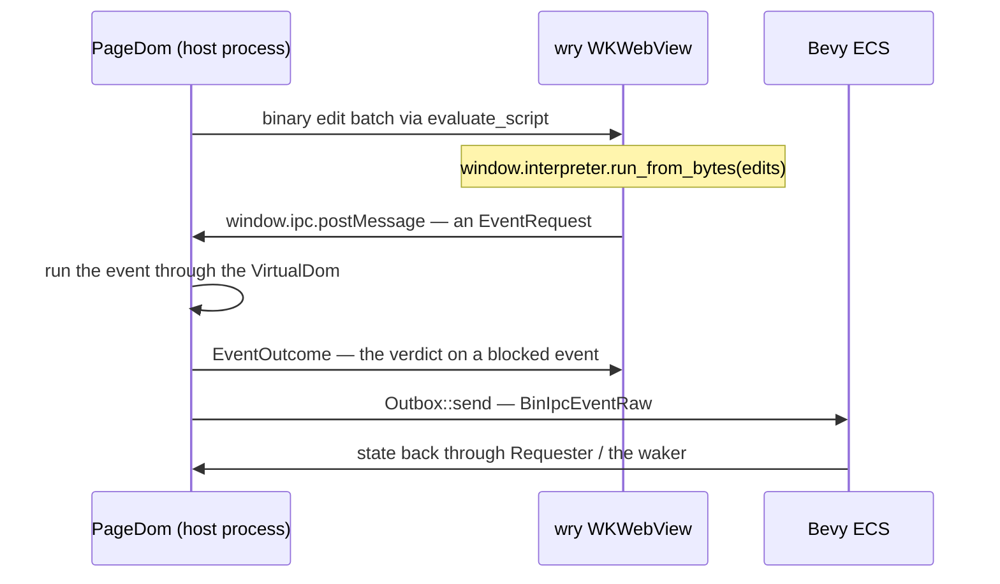

Everything the page loads arrives over a `vmux://` custom protocol registered on **that
webview**: the document, the rendered frames, the verdict on an event it is blocked on, and
every asset any of those reference. Native pages handle the same reload requests as CEF pages;
the native adapter reloads its document, and the document-load handshake advances its revision
and restores the current host state before accepting page input. Hard reload uses WebKit's origin
reload on macOS to bypass its cache. `Route` enumerates that list, so adding one is a variant
rather than another branch in a chain of string tests.

A page reaches the app through three channels, gathered once per app rather than per page:

| Channel | Carries |
|---|---|
| `bin_ipc` | the page's emitted events, as `BinIpcEventRaw`, into the ECS |
| `requester` | the page's requests for what the host must answer |
| `waker` | a nudge to the winit event loop so the frame is actually drawn |

One wart worth knowing: `BinIpcEventRaw` and `Requester` are **bevy_cef types**, reused as
the app's bus. Nothing about a native page's messages touches CEF — wry carries them end to
end — but the channel they land in is registered by a CEF plugin, so a wry page will not
build until that plugin has. The transport moved and the channel types did not.

### A controlled field belongs to the state

The page applies every `value` a batch carries, without judging it. That is worth stating
because the shim used to judge: it shadowed the `value` accessor on whatever field had
focus and dropped any write matching one of the last sixteen values the box had held, on
the theory that such a write was a late echo of an earlier keystroke about to clobber a
newer one.

The theory was sound and the rule was not, because "a value this box held before" is also
the exact description of a prompt recalled from history, and of the empty string a composer
returns to after sending. Walking back up the history worked and walking forward down it
silently did nothing; submitting left the sent text sitting in the box. Both looked like
state bugs and neither was — the state was right the whole way to the wire.

The race it guarded is closed further up. `answer_event` renders and hands the resulting
batch to the parked `/__edits` responder inside the event's own handler, and the page
reports events over a *synchronous* request, so the batch for a keystroke is queued before
the page can dispatch the next one. There is no window in which an echo arrives stale. A
field that state owns is only ever written by state, and the document does not get a vote.

### Who owns ⌘V

macOS hands a menu key equivalent to the menu **before** the key window's responder chain
sees a keyDown. So while the Edit menu's Paste item is enabled, no page can observe ⌘V as a
keystroke — the menu has already eaten it and dispatched `paste:` down the responder chain,
where the WKWebView answers with its own text editing.

That is what most pages want. Two do not: the terminal forwards the chord to a pty, and the
editor binds all five of ⌘C/⌘X/⌘V/⌘Z/⌘A to its own keymap, where the menu's undo would
rewind the wrong buffer. They can only see the raw keyDown if the menu item is disabled
while they hold focus.

A pane says which it is by carrying `BindsEditingChords`, and `sync_edit_menu_items` greys
the Edit menu for exactly those panes. The declaration is on the pane, not in the desktop
crate, because the hosting mechanism cannot answer the question: the composer and the editor
are both native panes, so anything keyed on `HostFocusIntent::NativePane` alone gives one
answer to two pages that want opposite things. Absence of the marker means platform text
editing, which is the default a new page wants.

The AppKit keyboard callback is only a transport adapter. It sends typed values through an
inbox component; `vmux_input` normalizes platform input and `vmux_shortcut` owns keymap sync,
chord state, page key claims, and command dispatch. AppKit does not retain pending application
state.

---

## Pages, and the trust boundary

What fills a pane is decided by its URL scheme.

| Scheme | What it is |
|---|---|
| `https://` | the open web — full Chromium |
| `file://` | a local file or directory, in the editor |
| `vmux://` | Vmux's own pages, served from bundled assets |

`vmux://` pages are not fetched from a server. They are answered from embedded assets by a
custom protocol handler, so a page loads instantly and offline.

`vmux_api::VmuxRoute` is the single parser and canonicalizer for those URLs. Browser dispatch,
history, layout placement, native-page ownership, and agent routing compare its host and path
boundaries instead of string prefixes. Legacy aliases are accepted at ingress and rewritten to
their canonical route before they enter page state.

"The workspace is an API" invites the obvious question: can a random website drive it?

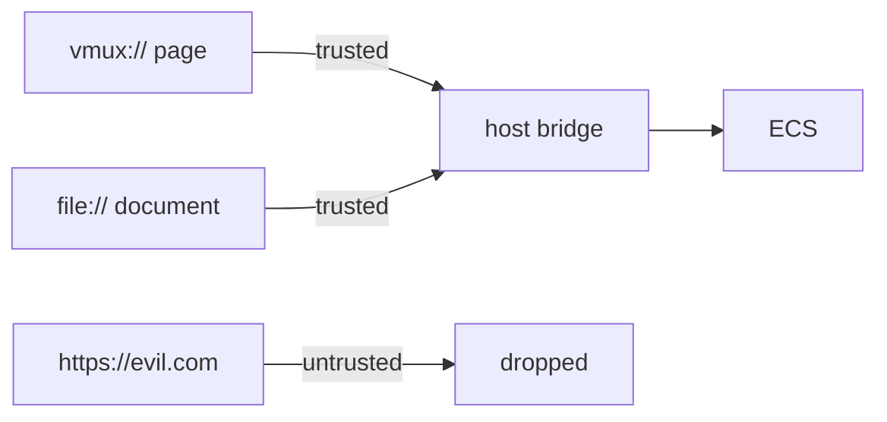

A frame is trusted only when Vmux itself served it. Because `vmux://` and `file://` come
straight from disk, no website can ever *be* at one of those URLs — the boundary is
unforgeable rather than merely checked. On the remaining CEF surfaces it is enforced **per
frame**, so an `evil.com` iframe inside a trusted page is still rejected, in the browser
process with a defence-in-depth check in the renderer.

Native pages get the boundary for free in a different way: their components run in the host
process and their webview is handed only its own `vmux://` protocol, so there is no bridge
for an arbitrary URL to reach in the first place.

A second layer adds least privilege *among* trusted pages: each message type is bound to
the pages that may emit it, so a compromised page cannot pivot to another's handlers. The
full Bevy Remote Protocol is locked to the `debug` page alone.

### Browser extensions

`vmux_extension` owns package metadata, installation, permissions, enabled state, catalog ECS,
runtime preparation, bridge transport, service workers, browser API projection, extension
popups, web-store injection, conformance tooling, and the manager page. `vmux_browser` exposes
only generic CEF primitives and lifecycle boundaries used by browser-backed features; it neither
depends on nor installs extension behavior.

An installed extension is never handed to CEF as it shipped. Vmux copies the package into a
generated runtime directory and patches the manifest so the service worker becomes a stable
`vmux_sw.js` that imports Vmux's bridge ahead of the extension's own worker. The package
itself stays immutable, so re-installing an extension or changing the bridge is a fresh
generation rather than a patch stacked on a patch.

That stable entry point has one consequence worth knowing. Chromium decides whether to
re-fetch a worker by comparing the bytes of its script, and `vmux_sw.js` is three
`importScripts` lines that never change — so a profile can keep serving the *previous*
package's worker from its script cache after the extension underneath it has been replaced,
and that worker then fetches chunks which no longer exist on disk. Vmux therefore
fingerprints the prepared runtimes and clears the profile's service-worker script cache
itself whenever that fingerprint moves.

Extension API requests cross from CEF to Bevy on socket threads while the app's event loop
is reactive. Enqueuing one wakes winit so a `tabs` or `windows` response never waits for the
next mouse or keyboard event. Web-page tab IDs are learned from content-script senders and
translated at the shim boundary; extension pages keep the model IDs the bridge owns.

---

## The daemon's registries

Two maps, and "registering" is inserting into one of them.

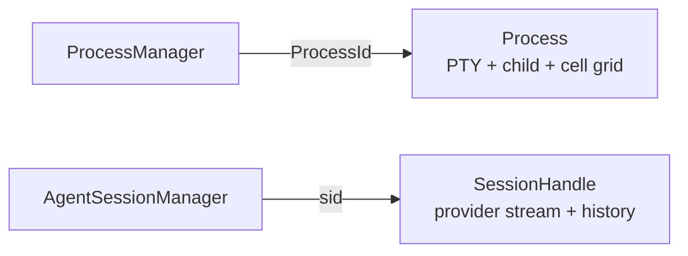

Each exposes the same two surfaces: a **broadcast channel** of updates, and a point-in-time
**snapshot**. Clients hold no state — they subscribe.

**Terminal.** `portable_pty` opens the PTY and spawns the shell; a reader thread pumps its
output through `alacritty_terminal`'s VTE engine into a cell grid. Each poll diffs the grid
by row hash and broadcasts only the **changed lines**. The page applies each patch to
per-row signals, so only those lines repaint. The daemon also owns what should outlive a
frame: OSC 133 command tracking, per-shell integration, copy-mode motions.
OSC 7 reports the shell's current directory through the same process subscription used by local
and remote terminals, independently of the launch directory. The Terminal breadcrumb shows that
directory and lists alternatives through the daemon. Choosing a directory sends a shell-escaped
`cd` only after the daemon verifies an empty prompt, unchanged directory and no intervening input;
running commands and input in progress reject the request instead of queuing it for later.
Host input is one ordered ECS entity per write, related to its terminal until the process is
ready. Multiple producers cannot overwrite one another through a singleton mailbox.

**Editor.** `syntect` plus `two-face` — the ~200 grammars from `bat` — highlight line by
line into `StyledSpan`s. The file viewer, the preview and git diffs all emit the same
spans, so code looks identical wherever it appears. No tree-sitter, no LSP. The host ships
only the visible slice of a file and re-slices as you scroll.

**Git.** The Git page and automatic Git-backed projections for the editor, Projects, Sessions and
ACP enqueue work and only project completed results. Their repository discovery, status
aggregation, directory reads and path resolution use one bounded worker runtime with separate
interactive and mutating-operation lanes. Repository refreshes are single-flight per checkout,
inactive views release their watches and tasks, and watcher bursts coalesce into invalidations; the
watcher never runs a Git command or filters paths synchronously. Each Git child process drains
stdin, stdout and stderr concurrently, has bounded output and a timeout, and is terminated when its
operation entity is discarded. Short metadata commands avoid a fixed wait; process polling backs
off only while a command remains running. Catalogs and diffs page at their source, so opening a page cannot
schedule work in proportion to the total repository history or block the ECS schedule. Branch
review advances one file and one bounded line window at a time; viewport demand requests another
window. A large lockfile therefore cannot produce an unbounded first render, and an idle review
cannot silently materialize the rest of the branch in the page DOM.
Visible placeholders request a path-specific seek without changing selection or history. Pending
seeks and their continuation windows take priority over background prefetch while retaining the
older batch for later. Prefetch proceeds through files beside the requested path before resuming
older batches. Demand uses the actual visible range rather than the larger render window;
generation checks discard requests from replaced sources while allowing background revisions
to advance without invalidating a path-specific request.
File, staged-only, dirty-buffer and submodule comparisons share the disk-spooled review source.
Syntax state and already generated lines are retained, while colors are generated only through
the requested viewport and cancellation stops further work. Collapsed unchanged ranges use the
same full-width hunk row and line-number gutter as the diff, with separate upward and downward
expansion controls and a whole-range reveal target.
The rendered diff subscribes to its scroll window independently of host data. Moving into a
loaded region replaces virtual spacers with its rows even when no new data arrives.
When earlier content changes height, the file and offset at the viewport define the next render
window. The DOM interpreter restores that anchor within the edit transaction, including scroll
clamping, before another input can arrive. Loaded content therefore stays in the rendered window.
File selection uses smooth scrolling and a stable `#diff-<SHA-256 of path>` anchor, matching
GitHub's pull-request file view. Scroll requests carry their own revision so repeated selection
of one file works and data refreshes cannot restart a completed scroll.
Changing the selected branch, commit, stash or file clears the previous source's viewport;
refreshing the same source retains its loaded rows. Owners keep the last diff generation across
discarded and restored queries, so old viewport demand cannot target a new source. Breadcrumb
menus toggle immediately on click while retaining their hover delay.
Viewed toggles and fold controls recompute the file header's offset after changing the collapsed
sections and move the render window to that offset. Native height transitions compensate the scroll
offset for a header already pinned to the viewport, and reveal a header elsewhere only when needed.
Their height transition captures the rendered body before the DOM edit and keeps an inert copy
only while closing. Native height animation lasts 160 ms, cancels cleanly when reversed, and is
limited to the visible viewport so long diffs still visibly open. Completion removes the animation's
filled height, allowing a later expansion to use its natural size. Reduced motion keeps header
alignment without animation; the model and its row virtualization commit immediately.
Reopening a repository retains the cached file list and diff across repeated restores while
refreshing them in the background. Repository and branch-file reads keep the diff surface in
its loading state until their own first result arrives. The file tree reserves skeleton rows
only while its first files are pending; cached trees and later pages retain their rows without
loading placeholders beneath them.

The host counts columns in **display cells** — `DisplayCells`, one per narrow character and
two per wide one — because wrapping and selection are grid problems and the host has no
font. Only the page can turn a cell into a pixel, so it does: it measures a narrow advance
and a wide one, and `ColumnRuler` walks the line's own text to place a caret, a selection
or a click. Multiplying a column by one character width is what put the caret past Japanese
text — Menlo's advance is 0.6 em, the CJK fallback's is 1.0, and 2 × 0.6 is not 1.0. No
font stack metric-locks its fallbacks, so the page measures rather than assumes. A cell
column is also not a character index: pointer columns arrive as cells and the host converts
once on entry, and the status bar reports the character column, as VS Code does.

---

## Mobile Remote

The desktop is behind NAT, so it dials out and holds the connection open. Three modules own
that on this side; what the relay does in the middle belongs to `vmux-cloud`.

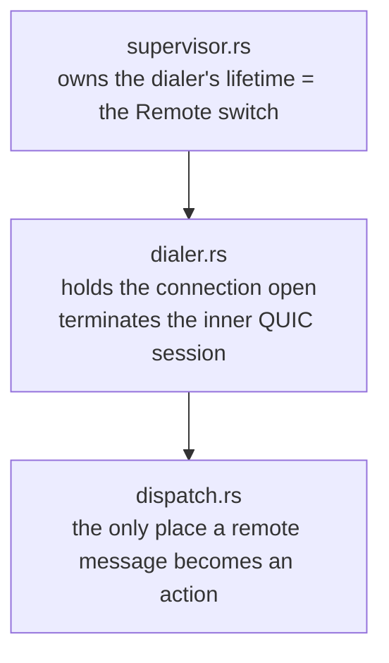

**The switch is a lifetime, not an access check.** Off means no dial, no registration and
nothing to retry. Gating admission alone would leave a desktop registered, retrying
forever, and advertised as one that refuses everyone.

**The dialer** redials on a doubling backoff from one second to thirty. A registration that
stood for a minute restarts the sequence, so a desktop connected for hours reconnects in a
second — and a relay that accepts a registration then tears it down mid-redeploy is not
mistaken for a healthy one. The phone's packets arrive as DATAGRAM frames and are handed to
an inner endpoint that terminates their QUIC session *here*: same certificate, same
`admit()`, same dispatch a phone dialling directly would have reached.

**Dispatch** enforces prompt size, replay dedup and attachment confinement once, rather
than at each of nine handlers.

### Pairing

No CA signs for a Mac, so the host mints its own certificate. The QR deep link carries the
relay routing credential, a one-use pairing credential, and the certificate's SHA-256. The
client pins that fingerprint and trusts nothing else — narrower than the public root set. A
pairing link without a fingerprint is **refused rather than downgraded**, because there is no
unpinned transport left to fall back to.

Successful pairing gives that client ID its own device credential and immediately rotates the
pairing credential. The host stores only device-credential hashes. Revoking one client removes
only its authorization and closes its live inner QUIC session; other clients and the desktop's
relay registration remain valid.

Discovery is manual by design. No mDNS, no zeroconf.

### Local and remote are the same client

A page never names a backend. It emits typed payloads under an event id, and a `PageHost`
decides what that physically means.

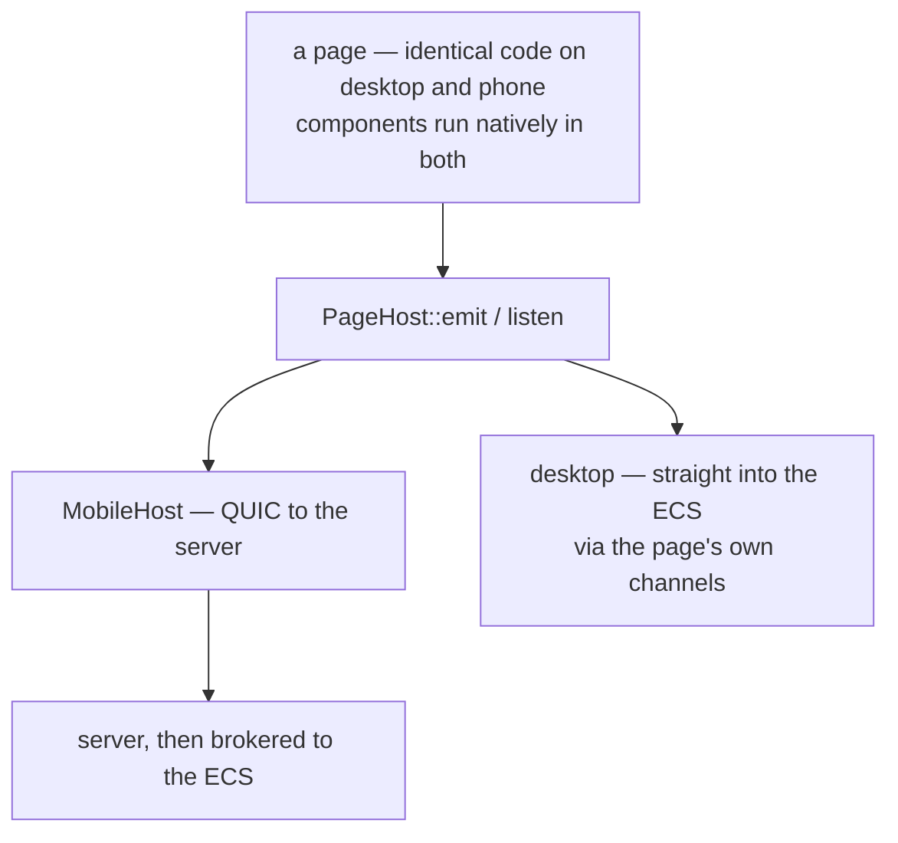

Both ends now run their components natively, so the old asymmetry — wasm in a webview on
the desktop, native on the phone — is gone, and with it `CefHost`. `MobileHost` is the only
`PageHost` implementation left; on the desktop a page reaches the ECS through its embedder's
channels directly.

What remains different is distance. Two current limits: `emit` is one-way on remote clients,
and subscriptions are still polled. `ListAgents` and `ListTeam` are brokered into the local
client's ECS rather than read from the server, so they answer `NoDesktop` until a window is
there to ask.

---

## Agents

Every action a person can take is also an **MCP tool**. Vmux ships a stdio MCP server —
line-delimited JSON-RPC in `crates/util/vmux_mcp` — so any MCP-capable agent drives the
workspace the way a person does.

The server is a thin front end: it forwards each call to the daemon over the unix socket.
The daemon owns the sessions, so work keeps running even if the agent process exits.

The MCP server is a headless Bevy app. Each decoded JSON-RPC request becomes an entity carrying
its id, method, parameters, and FIFO sequence; systems route it, attach an asynchronous task when
needed, build the response, and despawn it after stdout delivery. The runtime entity owns the
`McpServer` component and request sequence. Stdio framing stays outside the world as the transport
adapter.

Tools are long-lived entities. Their name, aliases, schema, availability, and publication order
are components seeded from feature-local RON manifests by the shared tool registry system. A
feature marks each typed argument component with `#[vmux_tool::input]`; the type name supplies the
manifest key, so plugin registration is `register_tool::<T>()` without a second string name. Each
handwritten feature exposes only its plugin; its private update systems consume matching tool-call
components, validate typed arguments, and produce command or query dispatch.
Publication and execution query those entities directly; there is no separate runtime registry or
central function-pointer table. ACP sessions install the same tool plugin into the application's
world and submit tool-call entities there; they do not maintain a nested or thread-local Bevy app.
`vmux_acp` carries only the ACP and query envelopes. Browser, capture, bookmark, vault,
simulator, and other feature plugins decode their own query contracts, emit their own ECS requests,
and map their results back to the service boundary. Feature-specific agent instructions and
disabled skill roots are components registered by those same plugins. ACP and CLI launch boundaries
aggregate that policy without enumerating or naming the features installed beside them.

Application commands follow the same ownership rule. The shared command registry seeds
command-definition entities from each registered feature manifest. Feature systems bind their
typed Bevy requests or observer markers to those entities through `CommandRegistry`. Optional MCP
metadata lives on that same definition. The MCP process asks the running application for its
command tools and forwards calls back to the command-definition entities. Systems query those
entities directly to resolve aliases, validate authorization and arguments, and emit the typed
request. There is no command-catalog resource, second command enum, or MCP-only command catalog.

Every agent is launched **anchored to its own Space**. Tool calls resolve relative to that
anchor, so a background agent cannot read or disrupt the space you are looking at.

Each ACP agent's default config file is authoritative for its native MCP servers. Vmux may discover
recognized native configs for read-only display, but never copies them into `tools.toml` or injects
them back into ACP session creation. Agent launch injects only the internal `vmux` MCP anchored to
the Session workspace. Profile-owned integrations and OAuth are a separate future feature rather
than another representation of agent-native MCP config.

`read_layout` / `update_layout` are the interesting pair: fetch the pane tree with stable
ids, mutate it, commit it back. Vmux diffs against the live graph and reconciles
React-style, in one atomic transaction.

---

## Platforms

### Manual iteration

```text
agent: make build-dev -> signed debug binaries -> user: make run-dev
```

Debug uses the full desktop feature set, Bevy dynamic linking, no LTO, and incremental
compilation. Build and launch are separate: run-dev verifies the completed artifacts and
never compiles or kills an existing app. build-local remains the bundle/OS-integration gate.

Local and debug share the workspace store and a stable Chromium directory per named profile,
not per worktree. On first use the most recently modified legacy local profile is reused
without merging or overwriting other profiles. Normal builds use the same Safe Storage key;
mock-key test sessions have their own data directory. Logs and service endpoints stay separate.
A process-lifetime desktop lock allows one GUI writer; desktop and daemon share a data lease
whose owner is the build and worktree. A different owner cannot start until both have exited,
and an endpoint lock prevents duplicate daemons from overwriting PID/socket files.
Quit flushes pending layout changes. Switching named profiles restarts the GUI rather than
opening another writer. Quit all old builds before switching; a daemon outlives its windows,
so service stop waits for its shutdown and lock release. Old binaries without leases are not
protected by these advisory locks. VMUX_DATA_DIR selects a separate data root and runtime
endpoints for copied-state tests. Incompatible stores are preserved and startup is refused;
changing persistence schemas against the live shared store is not an iteration shortcut.

| Platform | Role | Status |
|---|---|---|
| macOS | host | primary — packaged, launchd-managed, shipped |
| Linux | host | builds and tests in CI, not packaged |
| Windows | host | not started |
| iOS | remote client | linked in CI, packaged and shipped via `dx` |
| Android | remote client | configured, no platform code yet |

A remote client is strictly a client — the server half of `vmux_service` is compiled out.
`vmux_service` also owns its local connection, daemon control, paths, pairing, and authorization
APIs; these are facets of one service boundary rather than a separate generic client domain.
Persistent processes and their query runtime belong to this service boundary. Terminal pages
render and control those processes, but the service names and exposes process operations without
depending on terminal page concepts.
macOS process CPU percentages compare cumulative CPU nanoseconds with elapsed monotonic time
converted to nanoseconds; raw Mach clock ticks are not the same unit.
Repository project identity uses the primary checkout. Submodules resolve `core.worktree` from
their common Git directory; `.git/modules` is metadata, never a project root.

The CLI uses Clap only to parse argv. Feature crates contribute command metadata through local RON
manifests and own the typed request components and systems that execute those commands;
`vmux_app` only composes those plugins. A finite command runs in a short-lived Bevy app and
`AppExit` follows a typed result. Long-running MCP stdio remains a dedicated runtime over the same
feature-composed tool registry.

Two cfg aliases decide that split, emitted by `crates/build_platform_cfg.rs`: **`ui`** is
iOS or macOS, the surfaces that run pages; **`host`** is everything that is not iOS, the
desktop app and the daemon. Write `#[cfg(host)]` rather than a negation of target
predicates. Cargo's own `[target.'cfg(...)'.dependencies]` still has to spell the targets
out, because dependency resolution happens before any build script runs.

---

## Where a crate lives

```
crates/
├── app/                    something a user starts
│   ├── vmux_cli
│   ├── vmux_desktop
│   └── vmux_mobile
├── feature/                user-facing capability and page ownership
│   ├── vmux_acp
│   ├── vmux_command
│   ├── vmux_editor
│   ├── vmux_extension
│   ├── vmux_git
│   ├── vmux_history
│   ├── vmux_knowledge
│   ├── vmux_layout
│   ├── vmux_service
│   ├── vmux_session
│   ├── vmux_setting
│   ├── vmux_shortcut
│   ├── vmux_simulator
│   ├── vmux_space
│   ├── vmux_start
│   ├── vmux_team
│   ├── vmux_terminal
│   ├── vmux_tool
│   └── vmux_vault
└── util/                   reusable infrastructure without its own page
    ├── vmux_api
    ├── vmux_app            platform-neutral application plugin facade
    ├── vmux_browser        browser runtime and native-page renderer
    ├── vmux_clipboard
    ├── vmux_ecs
    ├── vmux_flex
    ├── vmux_macro
    ├── vmux_mcp
    ├── vmux_native         the VirtualDom driver and its wry webview
    ├── vmux_path           canonical and scoped path identities
    ├── vmux_profile
    ├── vmux_transport
    └── vmux_ui
```

Directory placement follows ownership, not dependency depth. A feature owns its page registration,
UI, host ECS, and domain behavior. Utilities may provide transport, rendering, shared types, or
application composition without owning a user-facing page. The `host` cfg alias describes compiled
code and has no directory counterpart.

Agent requests follow the same boundary. `#[vmux_api::agent]` generates only the opaque contract
for the type declared in a feature crate. That feature owns its manifest, registration, ECS routing,
handling, and result projection. `vmux_acp`, `vmux_mcp`, and `vmux_tool` transport and dispatch
opaque requests; they never enumerate browser, simulator, vault, layout, or other feature requests.
Only the application composition root knows which feature plugins are installed.
And the `host` cfg alias is **not** the directory: `vmux_ui` holds host-gated code while
staying flat.

`vmux_session` owns the durable unit of work: one canonical Session entity with its stable ID,
task metadata, working directory, data-driven stage, conversation-event children, optional agent
identity, and the derived Session catalog. Session creation generates its ID inside the typed
request and emits a typed creation event before navigation. Layout Stacks reference the Session
entity and may close without deleting it. `vmux://sessions/` opens the manager;
`vmux://sessions/{session_id}` opens a Session independently of its agent or provider conversation
identity. Session IDs are encoded as one URL path segment.
Conversation events persist their identities, contents, timestamps, and source markers with the
Session. Restore displays that history before runtime attachment; provider replay reconciles the
same event identities without duplicating cached messages.

`vmux_acp` attaches transient runtime and ACP capability state to Session entities and owns the
provider-owned `AcpSessionId`, its persistence, and the single runtime detach path used by cleanup
and agent replacement. `vmux_session` renders the
Sessions page and Dioxus conversation UI. A dedicated manager-view marker is the authorization and
publication boundary for Session catalog and mutation UI events; Session detail views receive only
their bound Session state. The service carries serialized agent protocol messages and runs
persistent daemon sessions; `vmux_acp` owns the client-host Bevy messages produced when those
wire messages enter ECS.

External session integration is a lifecycle-owned child plugin of `AcpPlugin`. It registers its
catalog, history and archive state, observers, and ordered systems through `Plugin::build`;
production and integration tests compose that same plugin through `add_plugins`.
Its archive child owns native archive requests, workers, and reconciliation. This compatibility
boundary remains necessary because the current ACP session catalog carries no archive state.

ACP `session/list` is the primary provider catalog. The Sessions page starts each installed ACP only
long enough to enumerate its paginated catalog, then stops it; transport failure does not switch data
sources. A bounded provider-store adapter is used only when no installed ACP owns that agent family
or the ACP explicitly omits `session/list`. Browsing an external entry does not copy it into durable
Vmux state. Resuming it creates the canonical Session entity, records its `AcpSessionId`, and lets
the provider replay the conversation through `session/load`. Compatibility watches exist only while
the Sessions page or one of their imported Sessions is present, debounce into one wake, rescan only
the changed provider, and bound untrusted history traversal.
Missing history resumes from the catalog owner's original provider ID. Cached continuations keep
their runtime resume ID. Unsupported or failed loads report an error and keep the Session's identity.
Empty replays preserve cached history, and failed loads release the loading state.
External history adapters feed the same Session events as ACP updates. Source keys match agent
family and provider ID. Failed resumes retain the canonical Session, read its original history,
and append only unseen content; replay matching ignores presentation metadata and normalizes
assistant-block grouping. Open read-only views share a sleeping 250 ms worker that checks only
known files. Changed files wake cursor reads; leaving the view or regaining the writer releases
those watches. macOS file notifications alone may wait for the writer to close its file.
Claude and legacy chat JSONL share one record decoder and bounded file lookup. Current Vibe
uses a small read-only adapter to its installed storage SDK, retaining its chunk cache and
watching CURRENT plus the active recovery journal. The normal app-server launcher performs
worktree cleanup, so this adapter imports storage directly and acquires no writer lease.
Native mutable history entries retain their IDs and update existing events without duplicating
unchanged entries. ACP tool kind survives replay and updates; names are fallback classification.
ACP sessions withhold startup snapshots until history replay finishes. Compatibility readers leave
their loading state to the ACP protocol; they read and complete only their own provider-store tasks.
History loading starts and finishes publish a fresh chat snapshot independently of message
changes, so empty or unchanged replays still release the conversation skeleton.
Initial and pending bottom scrolls retain their follow state through layout-driven offset changes.
Scrolling away from the bottom pauses following; input that leaves the viewport at the bottom
keeps it pinned, and returning to the bottom resumes it. Older history is requested only after
the initial scroll has settled. The latest tool batch stays expanded until every call has a result
and subsequent assistant text arrives; earlier batches remain folded. Tool rows share native
Claude/Vibe name classification and summarize wrapped Codex command batches as Ran, Explored,
or Edited. Exploration exposes Read, Search, and List steps from the actual shell commands.
The Session manager publishes only to its active page and leases Git metadata for every displayed
repository while that page remains active.
Its first discovery reserves a skeleton in one persistent scroll surface until rows are available.
Each provider publishes its completed catalog without waiting for other providers. Partial updates
keep existing rows and append new identities; a completed discovery can remove
missing identities without reordering the survivors. The view-control band and scrollbar gutter
keep their space during loading, with the selected view icon using the foreground color.
Once rows exist, background discovery never appends another initial-loading skeleton.
Git change counts live in the Space card with labels rather than as dots in the composer.
Startup failures retain their specific provider cause when the process exits. A conversation owned
by another client shows a neutral status card explaining that ownership, with retry and diagnostic
copy controls. Its composer disables input, attachments, sending and setting changes while keeping
the agent and known settings visible with a neutral ownership label. Ownership refusals cannot
enqueue prompts or clear drafts and attachments, and they do not emit an error toast.
Failed Codex resumes can read bounded local history under the original provider ID while retaining
the refusal; a successful retry or an already-populated transcript discards a late local read.
Retry preserves its provider identity and replaces only the failed local runtime.
Failed conversations release their transcript skeleton.
Composer workspace context resolves the Session named by the page URL even before runtime attachment
has bound the Stack. Unpublished context is retried after the first ready frame, so a late binding
cannot leave project and branch controls as placeholders. Branch menus enqueue their checkout reads
through `vmux_git::GitRuntime` and finish empty results rather than leaving a loading request open.
Project dashboards and resume suggestions use the same catalog stage and staleness projection.
Embedded Session groups show five entries at a time, with stale groups initially collapsed.
Resume suggestions restrict host contributions to the visible entries, so keyboard selection
cannot reach hidden sessions; each status has its own explicit expansion limit.
Project dashboards show related sessions, repository status and an entry point into Code,
without reading or listing arbitrary directories in the overview. Repository status uses the Git
feature's shared `RepositorySummaryRequest` subscription rather than loading a Git page. Reads
share a bounded worker task per requested root, publish only requested results, and settle failed
reads. Hidden pages release their tasks; returning pages retain their last result during refresh.
The repository root is a resource location, not a separate logical project identity.

The DOM interpreter measures the initial transcript rows before positioning them. Their
content-visibility estimates are replaced by real extents for the first paint, then normal skipping
resumes without waiting for fonts or streaming updates. History insertion captures the currently
visible row immediately before DOM edits and restores its position before paint, so loading cannot
replay an earlier scroll position over fresh input. A resize observer schedules following at browser
frames instead of writing layout from its notification loop. Any upward reading movement stops
following; only the actual bottom resumes it.

Session failures with a useful remedy occupy a light notification strip in the composer's outer
frame. The dark composer keeps its draft and metadata inside that frame. Busy sessions disable
editing, attachments and submission while Project and Branch menus remain usable. The notification
strip owns the locked-status message; the footer retains activity counts. Model and agent
configuration stays read-only. Busy sessions
explain where to release the writer; missing histories offer a new conversation; connection failures
offer retry. Other failures use a dismissible toast. Raw provider diagnostics remain in app logs.

Project summaries open Code through the same README-first entry selection. Direct directory routes
retain directory navigation. Code opens the owning Space's working directory and prefers its README, then a bounded set of
entry files, before falling back to directory columns. Directory pages use paths as page titles
and show columns without a duplicate Explorer tree. The outer editor container and the columns
share directory key handling; text view-mode updates cannot steal directory focus.
Git diff file placeholders come from the file catalog before the first diff viewport arrives,
so publishing file names does not create an empty interval while their bodies are still pending.
Editor route changes seed shared preferences into cold document state and retain the previous
presentation until the new mode's content is ready. Source rows wait for character measurements;
cursor and rendered-note state are projected together. Another checkout is a read-only preview
until project activation aligns the Space with that checkout, and the host rejects mutation and
Save requests while that preview remains active.
Page item close and reopen requests precede Stack fallback. Archive capture runs before source
destruction; the Editor persists ordered paths and selection and keeps unsaved buffers and Undo
in an in-memory archive companion. Restore transfers those into the new surface without saving.
Layout animation clocks start at the request, and one deadline scheduler drives their 16 ms wakes.
Sidebar content keeps its configured width while the reserved width and outer clip change, so pins
do not reflow through a zero-width column. Stack presentation rectangles interpolate structural
moves and resize and are consumed by both hosted child placement and native windowed frames.
Sidebar rows preserve their identity and animate from their previous DOM rectangles.
Ready Git pages retry checkout-context publication when parent or slot binding arrives late.

`vmux_profile` owns profile identity and filesystem locations. Tool inventory is a separate
capability in `vmux_tool`; consumers depend on it directly instead of reaching through a
`vmux_ecs` re-export. `vmux_tool` also owns the tool page, manifest, inventory lifecycle,
operation sequencing, and built-in Homebrew, NPM, MCP, and dotfile providers. Feature crates
register their own provider entities, such as ACP in `vmux_acp` and LSP in `vmux_editor`;
application crates only compose plugins. `vmux_path` gives filesystem boundaries one shared
identity rule and rejects scoped paths that traverse or resolve outside their root.
Tools use the shared workspace sidebar for category navigation and search; their URL trail is
Tools / category. Provider metadata publishes before inventory scanning finishes, and inventory
operations and view controls remain in the page. Project details publish Projects / project,
while Session directory links open the Code entry file. Branch controls share branch identicons. Session lists use the same board switch and column
icon in Project details. Popup dismissal starts after the first open, so mounting a closed native
popover cannot cancel its opening.

Repository tool versions live in `tool-versions.env`; CI loads the same values used by local
scripts and the Makefile. Release asset names and URLs come from
`scripts/release-artifacts.sh`, while the standalone installer selects the matching asset from
the published release instead of reconstructing its name.
