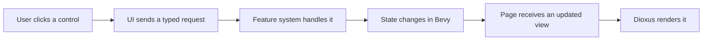

# How Vmux works

If you know React, start with the UI. Vmux uses Dioxus components written in Rust: a component receives props and returns markup with `rsx!`, much as a React component returns JSX.

The main difference is where application state lives. Most product state is held by Bevy, a Rust ECS library, outside the page. The UI displays that state and sends requests when the user interacts with it.

## From React to Vmux

| In a React application | In Vmux |
|---|---|
| A component renders JSX | A Dioxus component renders `rsx!`. |
| Props describe what to display | Props and `UiState` describe the page's current view. |
| A reducer or store holds shared state | Bevy components hold data on entities. |
| Dispatch sends an action | A typed event or message asks a system to do something. |
| An effect or service performs work | A system handles the request and starts IO when needed. |
| A feature module is wired into the app | A plugin registers the feature's data and handlers. |

These are comparisons, not identical APIs. In particular, a Bevy system is not a component effect: Bevy schedules it over the data it requests.

## Follow one interaction

A typical native-page interaction follows this path:

For example, a Terminal page can request input to a running process. The terminal feature handles the request; the background service manages the process. Output updates the terminal's display. Closing the page does not necessarily stop the process, so reopening it can show the same work.

The page can keep a text draft, caret position, or scroll locally, just as you would in React. A change to the actual project, selected session, process, or saved setting goes through the Rust handler. This keeps a second page, a remote client, and an agent in agreement.

## The four ECS words you need

An **entity** is an ID for something such as a page, process, or session. **Components** are pieces of data attached to that ID. A **system** is a function that reads or changes matching data. A **plugin** registers the components, messages, and systems for a feature.

Start at a feature's plugin to see its handlers. Then follow the event type to the system that receives it. You do not need to learn every ECS API before making a small change.

## Where the code lives

| Directory | What you will find |
|---|---|
| `crates/app/` | Desktop, mobile, and CLI entry points. |
| `crates/feature/` | Browser, Terminal, Code, Git, Session, layout, and other features. |
| `crates/util/` | Shared state, transport, storage, and other supporting code. |

A feature usually includes its UI, event types, handlers, and tests. `feature.ron` lists what it contributes, such as pages, commands, and tools. `vmux_app` connects features into the selected application.

The desktop displays pages and handles native integration. The background service keeps processes and conversations alive beyond a page. Mobile uses supported host features through a remote connection. Web pages stay ordinary browser content and do not receive unrestricted access to the host.

### ECS ownership boundaries

Filesystem, network, process, and native API calls sit behind adapters. Handlers decide what should happen; an adapter performs the outside operation and returns its result. Before applying a delayed result, the handler checks that it still belongs to the current task or page.

Development commands use the same model. Signing, bundle preparation, artifact checks, and provider execution advance through scoped systems. Each operation owns its accepted inputs, job order, and IO lifetime in Bevy. Canceling or retiring work waits for process and file cleanup before the CLI returns. Results from a replaced input, attempt, or owner are discarded, and independent operations can continue after that cleanup.

Target-lock acquisition is a scoped IO job. Inheritance uses the actual parent-process contract, so checkout configuration cannot bypass exclusion. An acquired lock stays with its step until ownership validation transfers it to the operation; canceled or discarded receipts release it after IO drains.

The repository's policy checks test these relationships. Ownership is inferred from the code; local `ecs-policy.ron` files carry migration debt and the exceptions the checker cannot infer. Read the feature's types, handlers, and tests first, and use a policy file when a check points to one.

Give independent operations separate typed requests and phases, and keep handlers focused on one stage. This makes ownership and failure paths visible when a feature grows. An adapter's exception describes its actual outside interface; it does not move the feature's decisions out of Bevy.

Startup migrations retain their accepted configuration and revision on the owning store until completion. Bookmark default seeding materializes pending pins as entities before ordering and publication, preserves custom pins and folders, and advances autosave when the same deferred-command drain completes.

CI sequencing belongs to the GitHub Actions workflow before product composition. Its Git adapter verifies the captured head/base merge and prepares identical checkouts for every runner; CLI artifacts bind their bytes to that checkout and run. PR validation performs no branch-run lookup or polling, so merge verification cannot wait behind a separate push workflow. Required statuses reject failed preparation and unexpected skips of applicable checks. Native distribution work remains outside ordinary PR validation.

Job-result reuse is a bounded read of Git tree entries and Actions job/artifact evidence. The workflow supplies job names, dependency/input paths, and the selected execution scope. Input claims remain runner-owned files and seven-day Actions artifacts; they grant reuse only with the matching successful job attempt in the same PR and base. No result lookup waits, retries, or starts a product operation. Changed inputs and unsuccessful latest attempts require fresh validation, and required statuses distinguish proven reuse from an unexpected skip.

## Native VM and Docker

`vmux_container` owns the pages, typed CLI/GUI requests, configuration, selection and canonical inventory. `vmux_vm` owns the leased native lifecycle and ECS dependency batches. Docker input becomes entities before dependency decisions or UI projection; the persisted inventory is a restore input, not a second live registry.

Container control uses separate start, stop, inspection, logs, configuration and container-change requests with concrete task results. The accepted operation owns its reply target, requester and cancellation handle; the engine's busy relationship decides which completion is current. UI operation choices only encode typed intent and a bounded display echo. Native connection systems own transport probing, forwarding, Docker readiness and port refresh in order, each with its own IO result. Docker methods issue one fixed HTTP operation; dependency batches request starts directly.

Startup and shutdown use exclusive process and guest-file leases. Operations own cancellation, so Stop can supersede startup and dependency work without an older completion replacing a newer request. The same stop receipt remains observed during preparation and readiness, including before the supervisor publishes its control socket. Bounded retirement cleans up helpers and forwarding while preserving guest disks. GUI Quit respects engine ownership; independent CLI engines and other profiles survive it.

Native adapters perform scoped filesystem, process, Docker, SSH and forwarding IO. Guest preparation verifies images and uses no-follow directory handles and atomic writes. The VMM runs in a signed helper because entering it takes over that process. Forwarding keeps attempted exposures until an authoritative receipt, preventing lost acknowledgements from leaking host listeners. The shared VM page placement and address scope retain one hosted surface during navigation.

See [VM and Docker](../ux/containers.md) for controls, automatic discovery and the supported port-binding scope. The first backend targets Apple Silicon macOS and Docker.

## What to read next

[Make a change](feature-development.md) walks through a feature edit. [Test and share a build](validation-and-release.md) gives the test and build commands. [Vmux Framework](framework.md) is optional reading if you want to build a different application from the same pieces.
