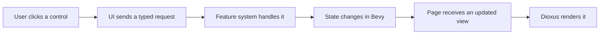

# How Vmux works

If you know React, start with the UI. Vmux uses Dioxus components written in Rust: a component receives props and returns markup with `rsx!`, much as a React component returns JSX.

The main difference is where application state lives. Most product state is held by Bevy, a Rust ECS library, outside the page. The UI displays that state and sends requests when the user interacts with it.

## From React to Vmux

| In a React application | In Vmux |
|---|---|
| A component renders JSX | A Dioxus component renders `rsx!`. |
| Props describe what to display | Props and `UiState` describe the page's current view. |
| A reducer or store holds shared state | Bevy components hold data on entities. |
| Dispatch sends an action | A typed event or message asks a system to do something. |
| An effect or service performs work | A system handles the request and starts IO when needed. |
| A feature module is wired into the app | A plugin registers the feature's data and handlers. |

These are comparisons, not identical APIs. In particular, a Bevy system is not a component effect: Bevy schedules it over the data it requests.

## Follow one interaction

A typical native-page interaction follows this path:

For example, a Terminal page can request input to a running process. The terminal feature handles the request; the background service manages the process. Output updates the terminal's display. Closing the page does not necessarily stop the process, so reopening it can show the same work.

The page can keep a text draft, caret position, or scroll locally, just as you would in React. A change to the actual project, selected session, process, or saved setting goes through the Rust handler. This keeps a second page, a remote client, and an agent in agreement.

## The four ECS words you need

An **entity** is an ID for something such as a page, process, or session. **Components** are pieces of data attached to that ID. A **system** is a function that reads or changes matching data. A **plugin** registers the components, messages, and systems for a feature.

Start at a feature's plugin to see its handlers. Then follow the event type to the system that receives it. You do not need to learn every ECS API before making a small change.

## Where the code lives

| Directory | What you will find |
|---|---|
| `crates/app/` | Desktop, mobile, and CLI entry points. |
| `crates/feature/` | Browser, Terminal, Code, Git, Session, layout, and other features. |
| `crates/util/` | Shared state, transport, storage, and other supporting code. |

A feature usually includes its UI, event types, handlers, and tests. `feature.ron` lists what it contributes, such as pages, commands, and tools. `vmux_app` connects features into the selected application.

The desktop displays pages and handles native integration. The background service keeps processes and conversations alive beyond a page. Mobile uses supported host features through a remote connection. Web pages stay ordinary browser content and do not receive unrestricted access to the host.

Session composition separates canonical mutation, Host behavior and page projection. `SessionDomainPlugin` owns identity, metadata and stage changes. `SessionHostPlugin` adds provider lifecycle, prompt queues, transcript/history ownership and the canonical catalog, with no page or implicit Profile file store. `SessionClientPlugin` owns page metadata and UI projection; desktop preferences are composed explicitly.

The application daemon uses `SessionHostRuntimePlugin` to compose that same public Host behavior with the existing service daemon and ACP process/agent runtime. Domain and Host consumers compile without the app feature or renderer. Native process work remains owned by the service/ACP systems. The reused Host boundary owns provider and transcript operations; Cloud-specific runtime enrollment and Host assignment remain in VMX-232/148. Client sync and gateway implementations can reuse the public records and domain operations without importing private Cloud storage or transport SDKs into the domain.

### ECS ownership boundaries

Filesystem, network, process, and native API calls sit behind adapters. Handlers decide what should happen; an adapter performs the outside operation and returns its result. Before applying a delayed result, the handler checks that it still belongs to the current task or page.

Development commands use the same model. Signing, bundle preparation, artifact checks, and provider execution advance through scoped systems. Each operation owns its accepted inputs, job order, and IO lifetime in Bevy. Canceling or retiring work waits for process and file cleanup before the CLI returns. Results from a replaced input, attempt, or owner are discarded, and independent operations can continue after that cleanup.

Storage, layout reset, tool bootstrap, and packaging also advance through registered systems.
Native process observations become canonical entities before cleanup decisions. Storage protection
preserves active builds, runtime libraries, and prepared artifacts while reclaiming eligible caches.

Desktop packaging owns its callbacks, CEF preparation, signing, and notarization in Bevy.
Standalone CLI releases use the same ordered publication journal. Keychain cleanup and publication
survive removal of the original step, and accepted root and attempt identity reject late receipts.
The CLI waits for native IO, keychain restoration, and rollback to drain before returning. Failed
cleanup retains and reports private recovery paths; source manifests remain unchanged.

Target-lock acquisition is a scoped IO job. Inheritance uses the actual parent-process contract, so checkout configuration cannot bypass exclusion. An acquired lock stays with its step until ownership validation transfers it to the operation; canceled or discarded receipts release it after IO drains.

The repository's policy checks test these relationships. Ownership is inferred from the code; local `ecs-policy.ron` files carry migration debt and the exceptions the checker cannot infer. Read the feature's types, handlers, and tests first, and use a policy file when a check points to one.

Layout display history belongs to each layout entity. Active-session projection retains a
loading page only while that page remains in the current pane tree, and owner removal retires
the history before reattachment. Task and workspace changes still flow from canonical state.
Each layout root compares its Transform with its current native window dimensions, so late
or rebound roots initialize immediately while stable geometry avoids repeated writes.

The Git push hook invokes Rust formatting directly, without compiling the development CLI
or running repository tests. CI owns the heavier compiler, DX/CLI lifecycle, ownership,
conventions, and platform checks. Targeted local tests cover the changed behavior;
`vmux dx test` remains available for explicit diagnostics.

CI validation builds use a stable validation identity instead of embedding the current Git
commit and worktree. This keeps unchanged crates reusable between checks; product builds
retain their normal identity. Compiler and CLI cache identities include this mode, so
validation artifacts cannot satisfy a product cache request. Release and local product
profiles always use real Git metadata. Nightly compiler caches retain content-validated
source timestamps in an isolated checkout, so they cannot rewind a standard target's
sources. They are warmed from main in a separate workflow, without
waiting behind the full main validation queue. Compiler fixtures and source checks remain
required and publish cache state only after successful validation.

Give independent operations separate typed requests and phases, and keep handlers focused on one stage. This makes ownership and failure paths visible when a feature grows. An adapter's exception describes its actual outside interface; it does not move the feature's decisions out of Bevy.

Cloud release snapshots become canonical ECS before consumers read decisions; unavailable input uses the declared default. Native extension bridge setup translates granted catalog permissions into initialization parameters; permission decisions stay in the catalog.

Startup migrations retain their accepted configuration and revision on the owning store until completion. Bookmark default seeding materializes pending pins as entities before ordering and publication, preserves custom pins and folders, and advances autosave when the same deferred-command drain completes.

Tab directory observations retain their last Git identity on the tab itself. The worktree
system validates that identity against the current startup directory and Git filesystem
metadata before deciding whether to reuse it or resolve again. Read observations can follow
another checkout of the same repository; edit observations can select a different repository.
Repeated observations keep their input order. Tab removal retires its transient identity,
including removal and reattachment in one update, without changing persisted workspace data.

Native window-button visibility is projected from headers in the same window. The
registered layout system requests one native update and records its successful visibility
on the Window entity. Missing native handles leave the request unacknowledged for the next
update; unchanged acknowledged state emits nothing. Removing the Window retires the
receipt, so reattaching it reapplies visibility even when the header state is unchanged.
The AppKit adapter performs only the requested button update and retains no layout state.

Browser update notices retain their last published state on the receiving LayoutCef
entity. The registered projection reads the current update state and page readiness,
publishes typed UI patches only when needed, and records the publication in the same
deferred-command drain. An unavailable browser records nothing. Removing LayoutCef
retires its receipt, including same-update reattachment; other layouts keep their own
publication history. Non-idle notices replay after page readiness changes.

CI sequencing belongs to the GitHub Actions workflow before product composition. Its Git adapter verifies the captured head/base merge and prepares identical checkouts for every runner; CLI artifacts bind their bytes to that checkout and run. PR validation performs no branch-run lookup or polling, so merge verification cannot wait behind a separate push workflow. Required statuses reject failed preparation and unexpected skips of applicable checks. Native distribution work remains outside ordinary PR validation. Heavy validation remains applicable after preparation failures but cancels when a PR run is superseded, so it cannot hold the concurrency slot for the new head.

Compiler caches restore workspace artifacts together with content/mode-validated source timestamps. Each restore retains a target-specific receipt and its original key/path configuration. Successful workflow steps checkpoint the snapshot and explicitly upload it with the artifacts before dependency-cache post cleanup can prune them. Publication never depends on nested composite outputs surviving into a post action; changed compile environments during the job cannot redirect the save to another partition.

Development CLI binary reuse has a separate input identity: Cargo's resolved normal/build dependency closure, tracked package and shared build-helper bytes/modes, locked dependencies, pinned tools/configuration, actual compiler and runner platform, compile settings, and the embedded update-verification key. Per-file content digests keep input boundaries unambiguous when files are added or deleted. An exact cache hit verifies the manifest and executable checksum before installation; missing or rejected bytes require compilation. Actions scopes isolate unmerged PR caches and expose main caches to PRs. Reused binaries are republished with the current checkout/run identity, so consumers retain their same-run provenance checks. The CI-only CLI does not expose the Git identity emitted by shared build helpers; those helpers remain compile inputs. No compiler cache lookup bypasses validation-result requirements.

Job-result reuse is a bounded read of Git tree entries and Actions job/artifact evidence. The workflow supplies job names, dependency/input paths, and the selected execution scope. Input claims remain runner-owned files and seven-day Actions artifacts; they grant reuse only with the matching successful job attempt in the same PR and base. No result lookup waits, retries, or starts a product operation. Changed inputs and unsuccessful latest attempts require fresh validation, and required statuses distinguish proven reuse from an unexpected skip. Lint claims include website sources because its ownership audit reads them; website compilation also follows docs and shared build configuration.

PR validation selects directly changed package targets, including member manifests and build scripts. Dependencies compile normally without selecting unchanged consumers for tests or Clippy. Current dependencies and changed historical manifests remain reuse inputs; deleted or renamed names never become Cargo targets, and empty scopes never invoke Cargo defaults. Full Rust validation remains on main, scheduled/manual runs, and shared workspace, lockfile, toolchain, build-helper, or CI changes. Unknown package ownership reports the path instead of expanding PR validation.

SDK and headless checks follow their application/consumer roots, lean checks follow the desktop root, and record/renderer-free checks follow their owning code. CLI-only ECS edits do not select record checks. Cargo's Linux feature trees and historical dependencies bind each selected suite's reuse inputs. Preparation publishes one scope for all runners. DX lifecycle and repository policy tests run in Lint rather than repeating in the ordinary Rust test job.

`cargo lint` delegates to DX. A private compiler plugin owns the accepted lint request,
configuration, preparation stages and target lease. Concrete file/process jobs perform
bounded IO; registered systems choose stages, retain cancellation ownership and stop after
failure. Compiler systems check capacity before and after acquiring the target lease.
CI and `vmux dx test` use this same request. Compiler tools and artifacts use dedicated
nonsymlink caches guarded before and after lock acquisition.

The Dylint library is an isolated workspace pinned to a dated nightly; product builds keep
stable Rust. Its external rustc callbacks resolve actual Bevy registrations and module
visibility, including aliases and configuration wrappers. Regression programs are ordinary
Rust files under `ui/`, materialized in a temporary Cargo project with independent
expected diagnostics. Source audits recognize input data through current content hashes and
actual inclusion by its test-owned Cargo harness. The same proof is used for ownership and
conventions, and inputs compiled as product modules or library/binary targets are refused.

Source ownership audits reuse completed namespace/module/declaration lookup answers within one
source inventory. Recursive probes retain their original cycle/ambiguity context and do
not publish partial answers. Source arrival and module rebinding invalidate the lookup
memoization; declaration results also restore the caller traversal state. Every audit still
evaluates current ownership, shape and provenance.
No lookup result persists between invocations.

Current ownership checks remain active until equivalent typed checks replace them; VMX-253
still requires zero migration debt and eventual removal of `ecs-policy.ron`.

## Native VM and Docker

`vmux_container` owns the pages, typed CLI/GUI requests, configuration, selection and canonical inventory. `vmux_vm` owns the leased native lifecycle and ECS dependency batches. Docker input becomes entities before dependency decisions or UI projection; the persisted inventory is a restore input, not a second live registry.

Container control uses separate start, stop, inspection, logs, configuration and container-change requests with concrete task results. The accepted operation owns its reply target, requester and cancellation handle; the engine's busy relationship decides which completion is current. UI operation choices only encode typed intent and a bounded display echo. Native connection systems own transport probing, forwarding, Docker readiness and port refresh in order, each with its own IO result. Docker methods issue one fixed HTTP operation; dependency batches request starts directly.

Startup and shutdown use exclusive process and guest-file leases. Operations own cancellation, so Stop can supersede startup and dependency work without an older completion replacing a newer request. The same stop receipt remains observed during preparation and readiness, including before the supervisor publishes its control socket. Bounded retirement cleans up helpers and forwarding while preserving guest disks. GUI Quit respects engine ownership; independent CLI engines and other profiles survive it.

Native adapters perform scoped filesystem, process, Docker, SSH and forwarding IO. Guest preparation verifies images and uses no-follow directory handles and atomic writes. The VMM runs in a signed helper because entering it takes over that process. Forwarding keeps attempted exposures until an authoritative receipt, preventing lost acknowledgements from leaking host listeners. The shared VM page placement and address scope retain one hosted surface during navigation. Operation errors retain their completion source, so a successful log retry clears that log failure without hiding another operation failure.

See [VM and Docker](../ux/containers.md) for controls, automatic discovery and the supported port-binding scope. The first backend targets Apple Silicon macOS and Docker.

## What to read next

[Make a change](feature-development.md) walks through a feature edit. [Test and share a build](validation-and-release.md) gives the test and build commands. [Vmux Framework](framework.md) is optional reading if you want to build a different application from the same pieces.

The desktop CLI spelling resolves to the existing launch intent. Command parsing supplies
no branch when it is omitted, so repository selection retains the current checkout instead
of silently choosing main. Desktop has no platform override; generic run retains explicit
platform selection. Both spellings share artifact readiness, ownership and launch cleanup.
