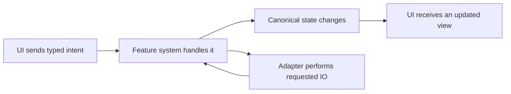

# How Vmux works

Vmux uses Dioxus for the UI and Bevy for application state. A page renders the current view and sends typed intent; registered systems decide what changes. This keeps windows, remote clients and agents working from the same state.

## From React to Vmux

| In React | In Vmux |
|---|---|
| A component renders JSX | A Dioxus component renders `rsx!`. |
| Props describe the view | Props and `UiState` describe the current view. |
| A shared store holds state | Bevy components hold state on entities. |
| Dispatch requests a change | A typed event or message asks a system to act. |
| An effect performs outside work | An adapter performs IO requested by a system. |
| A feature is wired into the app | A plugin registers its data, systems and contracts. |

An entity identifies something such as a page, session or operation. Components hold its state. Systems read and change that state; plugins compose them into the application.

## Follow one interaction

A page may keep a draft, caret or scroll position locally. Changes to shared work go through the owning system. Closing a page does not necessarily stop its conversation or process; reopening it can show the same ongoing work.

Transcript delivery selects a page target on the canonical Session, applies queued-input updates, and publishes through ordered systems in the same frame. The temporary target is removed after delivery or deferral; the page publication capability only hydrates and emits the typed snapshot.

Native breadcrumb labels and parent links resolve from registered feature manifests and page declarations using the actual routed URL. Shared DOM document URLs do not determine navigation identity. Features add contextual entries; the host corrects a contributed root that belongs to a different route. A child route in `feature.ron` needs no separate breadcrumb registration.

## Where the code lives

| Directory | Responsibility |
|---|---|
| `crates/app/` | Desktop, mobile and CLI products. |
| `crates/feature/` | User-facing capabilities, including their UI and behavior. |
| `crates/util/` | Reusable infrastructure and composition. |

`feature.ron` declares a feature's contributions and optional public compatibility contract. `vmux_feature` owns their parsing, validation and registration. Page and command macros bind Rust types to those declarations; generic ECS infrastructure consumes derived metadata. The existing feature entities own dependencies, capabilities, requested permissions and lifecycle metadata; the registry freezes their contributions. Application composition selects a target and the host's capability/policy facts. Registered validation refuses unsupported compositions before Startup. Metadata cannot install plugins, call lifecycle callbacks or grant OS access; feature systems and platform adapters retain those responsibilities.

Domain state, host behavior and UI projection compose separately, so headless consumers can use host capabilities without importing a renderer. Applications finish and clean up plugins before running their selected runner. Feature-owned operation/job schedules govern accepted work, cancellation and IO drain. Private Cloud integrations remain outside the public client's dependency graph.

The web host package is a versioned declaration envelope pinned to the host's immutable SDK revision. It uses the same canonical feature manifest and startup URL, while a registered observer checks its presentation-only boundary against the host's typed event contract. Native capabilities and operations come from linked plugins; a package cannot supply executable handlers or permission grants. Startup publishes the accepted feature entity once for the selected renderer adapter. Product identity, signing and release policy remain host-owned.

The desktop hosts pages and native integration. Background services retain processes and conversations beyond a page's lifetime. Remote intent enters typed service operations before validation, broker dispatch or filesystem selection; transport adapters submit individual IO requests and return their facts. The same canonical request payload can cross network and agent envelopes while their wire selectors remain stable. Mobile connects to supported host capabilities. Ordinary websites do not receive unrestricted host access.

### ECS ownership boundaries

Canonical entities own domain state and accepted operations. Registered systems own selection, reconciliation, queues and transitions. Resources represent global facts; indexes and UI views derive from canonical state. Independent operations use separate typed requests.

Adapters translate foreign input or perform bounded filesystem, network, process and native IO. They do not retain a parallel business model or hide workflows. Native input enters ECS before shortcut or capture decisions. Native handles may stay in an adapter until delivery and cleanup finish.

Delayed input and IO results carry their accepted owner and attempt identity. Systems reject results for retired or replaced work. Cancellation retains operation and IO ownership until drain and cleanup complete. Removing an owner retires its transient history; a replacement reconciles from current state. Unavailable delivery is not acknowledged as success.

Persistence restores canonical state rather than creating another live registry. Native presentation and UI projection retain only the history needed to deliver that state. The relevant code and tests define feature-specific ordering and recovery behavior.

Feature flag inspection and administration share the public snapshot contracts. Application composition installs shared polling once and binds cloud gates to the selected release provider. Administration reuses a matching provider endpoint; inspecting another environment cannot redirect a cloud gate. The optional page projects canonical declarations, draft values and publication history through the existing managers. Draft edits remain separate from published decisions; the server owns authorization and durable publication. A review binds the draft and published base revisions, and a lost publication response keeps its operation identity until reconciliation. Native completions cannot transfer data or permissions across a replaced endpoint or credential. The native Account broker owns short-lived Control credentials; application composition projects only its source reference into feature requests and delivers derived leases through the authenticated local desktop/daemon channel. Credentials never enter targeting, UI or persisted feature state.

Source and compiler checks derive ownership and boundary evidence from the implementation. Stateless Bevy composition is proved from its real framework interfaces and registered systems. Temporary `ecs-policy.ron` records track remaining migration debt and boundaries that lack equivalent automatic proof. Remove those records as proof becomes available; completion requires the checks to pass without policy files.

Account systems combine release availability with secure credential support before accepting cloud authentication or sync consent. Native adapters retain bounded IO ownership, while connection and credential generations reject obsolete results. Authenticated binding preserves local Account and Profile identities; explicit unlink clears sync selections atomically. Accepted persistence outlives a page, failed saves preserve committed state, and credentials stay outside reflected records and UI views.

Selected Profile sync uses durable local records and an idempotent outbox. ECS systems decide uploads, reconciliation, conflicts and retries; adapters perform individual network or SQLite operations. Failed saves preserve committed values and pending work, stale Account results cannot affect the current binding, and a remote tombstone preserves local files. Conflict resolution requires the displayed revisions and identity to remain current.

Live declares its installation-scoped availability in the renderer-free Remote domain. Desktop and daemon composition each install their own evaluation and retention state. The optional native host projects UiRemote, and Layout includes that snapshot in its existing header page. The requested preference stays separate from flag availability and pairing presentation. The daemon publishes epoch/revision observations through the local service stream, so pairing and local file completions cannot overwrite its observed phase. A stop remains pending until accepted native work drains.

Daemon systems combine their own current decision with the stored preference and retain accepted native dial inputs and the initial decision through connection retirement. A closed gate refuses incomplete setup and control streams; local Session and process ownership remain with their host features. Development and local products may use explicit loopback endpoints and certificate pinning. Release products retain production configuration and certificate verification. Enabling Live does not select Profiles for synchronization.

## Development and validation

Fresh onboarding launches create a private temporary data tree through a typed IO job, override the launch profile and environment-key mode, and retain that tree only after a successful launch. Normal launches preserve the requested data and profile.

Development CLI operations follow the same ownership model as product work. Systems sequence builds, signing, packaging, CI planning, evidence validation and cleanup. CI composes the development feature without the desktop runtime; Git, Cargo, filesystem and Actions adapters return bounded facts to accepted operations. Leases protect active work and shared artifacts; cancellation drains IO before returning.

The push hook checks Rust formatting. CI owns Clippy, repository policy, lifecycle and platform validation; targeted tests cover behavior during iteration. Product builds retain their real identity. CI artifacts and results can be reused only with matching inputs and successful validation, so caching cannot substitute for a required check.

Compiler tooling uses an isolated pinned toolchain. Ownership audits operate on the current source inventory; lookup memoization lasts only for that inventory and does not reuse audit decisions. See [Test and share a build](validation-and-release.md) for commands.

## Native VM and Docker

Container features own configuration, selection and canonical inventory; the VM lifecycle owns native processes and leases. Scoped adapters perform guest, Docker and forwarding IO. Operations retain cancellation and cleanup ownership so stale completions cannot replace newer work.

Cleanup preserves guest disks and unrelated engines. See [VM and Docker](../ux/containers.md) for controls and supported networking.

## What to read next

[Make a change](feature-development.md) follows a feature interaction. [Vmux Framework](framework.md) explains reusing features in another application. Code, typed contracts and tests remain the source for implementation details.
