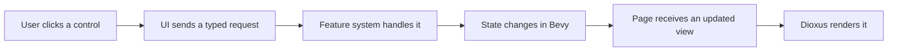

# How Vmux works

If you know React, start with the UI. Vmux uses Dioxus components written in Rust: a component receives props and returns markup with `rsx!`, much as a React component returns JSX.

The main difference is where application state lives. Most product state is held by Bevy, a Rust ECS library, outside the page. The UI displays that state and sends requests when the user interacts with it.

## From React to Vmux

| In a React application | In Vmux |
|---|---|
| A component renders JSX | A Dioxus component renders `rsx!`. |
| Props describe what to display | Props and `UiState` describe the page's current view. |
| A reducer or store holds shared state | Bevy components hold data on entities. |
| Dispatch sends an action | A typed event or message asks a system to do something. |
| An effect or service performs work | A system handles the request and starts IO when needed. |
| A feature module is wired into the app | A plugin registers the feature's data and handlers. |

These are comparisons, not identical APIs. In particular, a Bevy system is not a component effect: Bevy schedules it over the data it requests.

## Follow one interaction

A typical native-page interaction follows this path:

For example, a Terminal page can request input to a running process. The terminal feature handles the request; the background service manages the process. Output updates the terminal's display. Closing the page does not necessarily stop the process, so reopening it can show the same work.

The page can keep a text draft, caret position, or scroll locally, just as you would in React. A change to the actual project, selected session, process, or saved setting goes through the Rust handler. This keeps a second page, a remote client, and an agent in agreement.

## The four ECS words you need

An **entity** is an ID for something such as a page, process, or session. **Components** are pieces of data attached to that ID. A **system** is a function that reads or changes matching data. A **plugin** registers the components, messages, and systems for a feature.

Start at a feature's plugin to see its handlers. Then follow the event type to the system that receives it. You do not need to learn every ECS API before making a small change.

## Where the code lives

| Directory | What you will find |
|---|---|
| `crates/app/` | Desktop, mobile, and CLI entry points. |
| `crates/feature/` | Browser, Terminal, Code, Git, Session, layout, and other features. |
| `crates/util/` | Shared state, transport, storage, and other supporting code. |

A feature usually includes its UI, event types, handlers, and tests. `feature.ron` lists what it contributes, such as pages, commands, and tools. `vmux_app` connects features into the selected application.

The desktop displays pages and handles native integration. The background service keeps processes and conversations alive beyond a page. Mobile uses supported host features through a remote connection. Web pages stay ordinary browser content and do not receive unrestricted access to the host.

### ECS ownership boundaries

Filesystem, network, process, and native API calls sit behind adapters. Handlers decide what should happen; an adapter performs the outside operation and returns its result. Before applying a delayed result, the handler checks that it still belongs to the current task or page.

The repository's policy checks test these relationships. Ownership is inferred from the code; local `ecs-policy.ron` files carry migration debt and the exceptions the checker cannot infer. Read the feature's types, handlers, and tests first, and use a policy file when a check points to one.

## What to read next

[Make a change](feature-development.md) walks through a feature edit. [Test and share a build](validation-and-release.md) gives the test and build commands. [Vmux Framework](framework.md) is optional reading if you want to build a different application from the same pieces.
