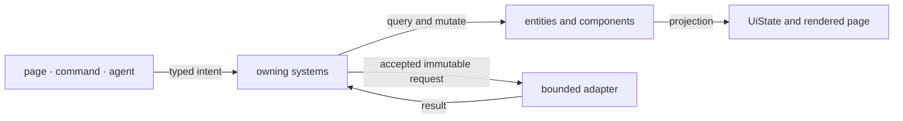

# Feature development

Start with the user-visible behavior and find its owning feature. An endpoint, menu item, or page should extend that owner rather than create another integration layer.

## Change routing

| Change | Start with |
|---|---|
| Product behavior, page state, or persistence | The owning crate under `crates/feature/`. |
| Runtime composition or native host integration | The application root and platform adapter. |
| Shared infrastructure or transport contract | The existing capability owner and consumers. |
| Developer command, build, or repository check | `vmux_dx`, its manifest, and native/test boundaries. |
| Experience or design guidance | The relevant UX or DX topic. |

Read the root plugin as the feature's table of contents. Registered systems, typed requests, the manifest, and behavioral tests show the current flow. Documentation is not a substitute for those interfaces.

## Feature design flow

Identify the owner, independently addressed entities, contracts, schedule ordering, and IO lifetime before editing. Trace success, failure, cancellation, retry, and restoration through that model. A system's parameters make its state access and dependencies visible.

Retain the original owner and accepted input across a boundary. Reparenting, replacement, or a newer revision can invalidate a result. Check validity when it is applied, not only when the worker returns.

## Native UI

The host owns product decisions. A native page sends `UiEvent` intent and renders `UiState`. Drafts, caret, IME composition, pointer geometry, focus, and scroll can remain local presentation state; they do not replace host selection or persistence.

Current values belong in state. One-shot notifications and requested DOM effects use typed events/effects. Keep page permissions and contributions in the owning manifest. Reuse shared layout, commands, and tools instead of defining page-only registries.

Locate the element inside its existing container before changing layout. Preserve the user flow: immediate feedback, stable reading position, usable prior presentation, and localized controls. Use the [feature guides](../README.md#ux) to understand the task the person is trying to complete.

## Prove the behavior

Test observable regressions with an independent oracle. Install the production plugin and use its schedules/messages for ECS tests. At boundaries, test framing, refusal, cancellation, or persistence. For visible interactions, inspect DOM behavior and resulting state.

Avoid tests that mirror constants, constructors, CSS literals, or implementation shape. DX policy checks enforce coding and ownership rules; fmt and Clippy own formatting and standard diagnostics.

## Finish the change

Run the targeted checks in [Validation and release](validation-and-release.md), then the pre-push gate. Prepare an artifact for required manual app QA and let the person exercise it. Update a UX/DX topic only when a durable expectation or boundary changes; keep method-level details in names, types, and tests.

Follow [AGENTS.md](https://github.com/vmux-ai/vmux/blob/main/AGENTS.md) for delivery and cleanup rules.
